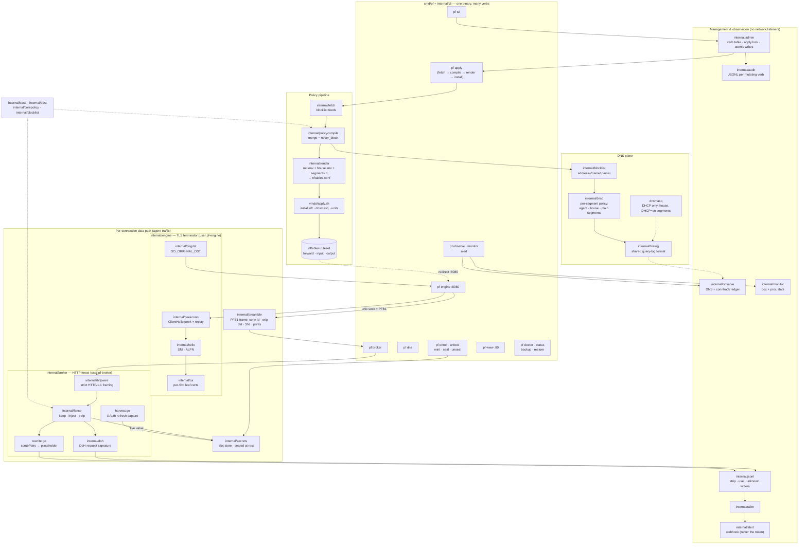
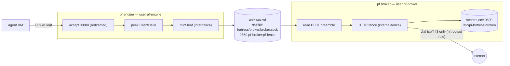
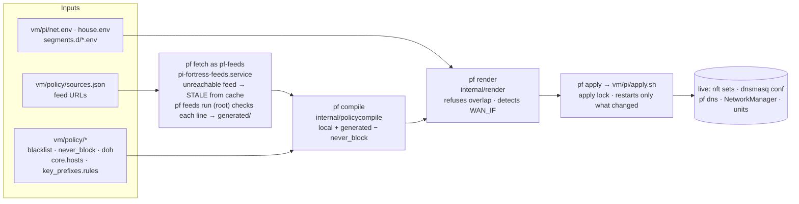
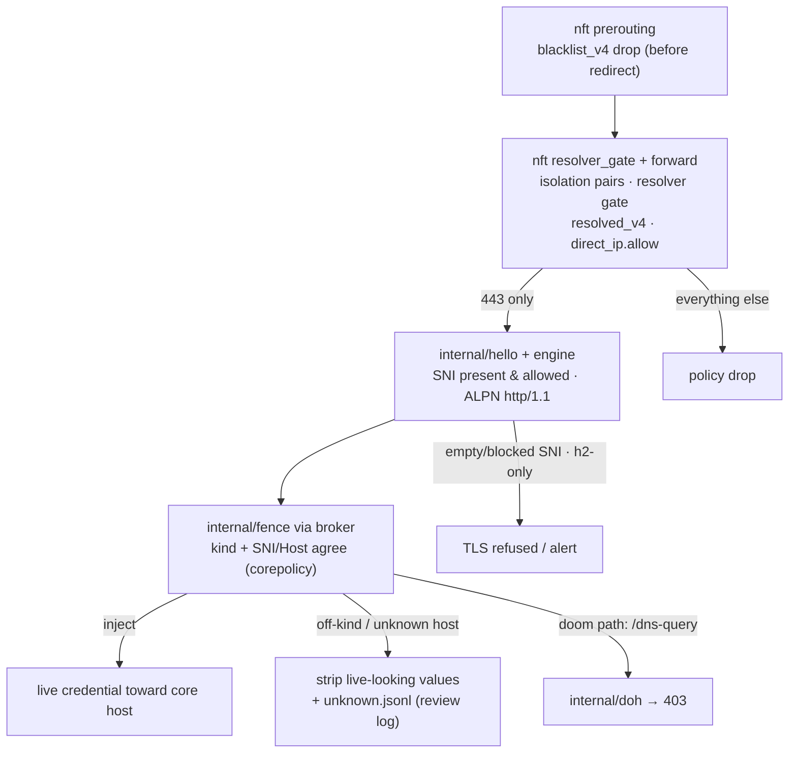

# Architecture — how the code and modules fit together

The system has:

- One binary (`cmd/pf` + `internal/cli`).
- Two enforcement tiers (engine + broker).
- One policy pipeline (fetch → compile → render → apply).
- One management plane with no network listener.

The labels name the real files. The code itself is the authoritative
table.

## 1. The whole system on one page

## 2. The two-process privilege split

The engine sees ciphertext and ClientHello messages. The broker sees
plaintext and live credentials. The two must not share a process
(`docs/privilege_split.md`):

The group `pf-fence` controls access to the socket. Each other daemon
unit lists the broker directory in `InaccessiblePaths`. Only root can reach
the admin socket (`/run/pi-fortress/broker/admin.sock`, 0600,
pf-broker). The full model of the TUI is "the operator's sudo".

## 3. The policy pipeline (config → running fence)

A refusal at any step leaves the previous ruleset loaded. A golden file
pins the no-house render. Thus a drift makes a test fail, not a device.

## 4. Where a decision is made (layer stack)

This diagram shows, in order, each module that answers the question
"may this connection exist?":

Tutorials 03–06 explain each layer in detail.
