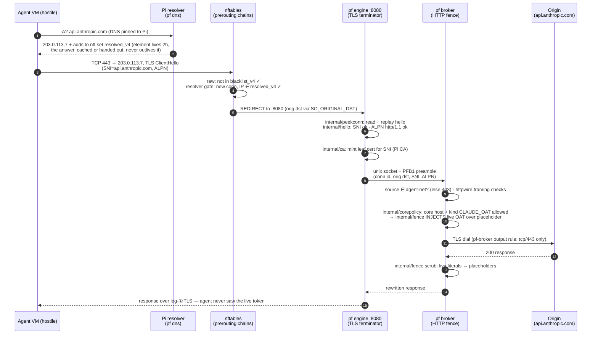
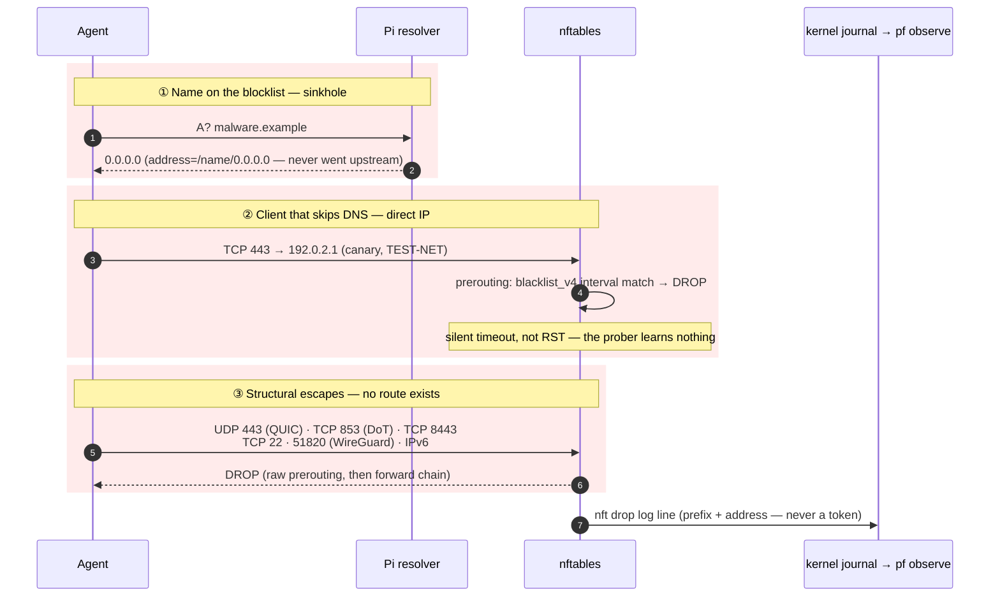
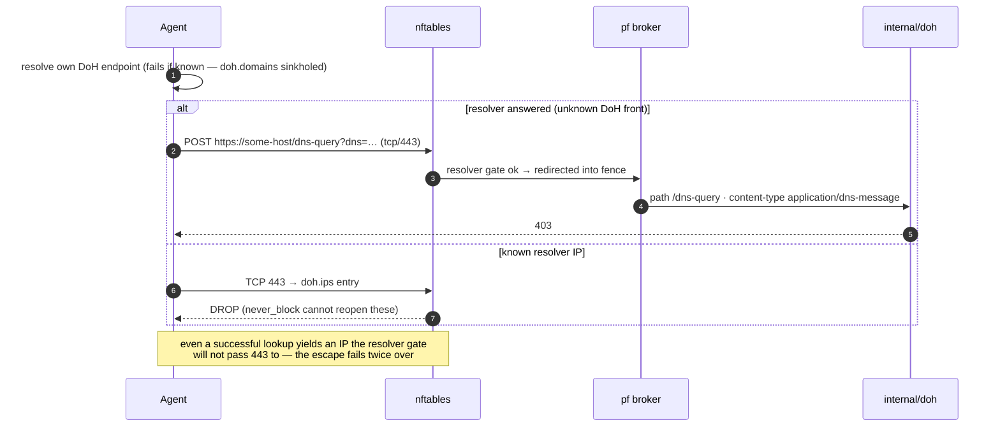
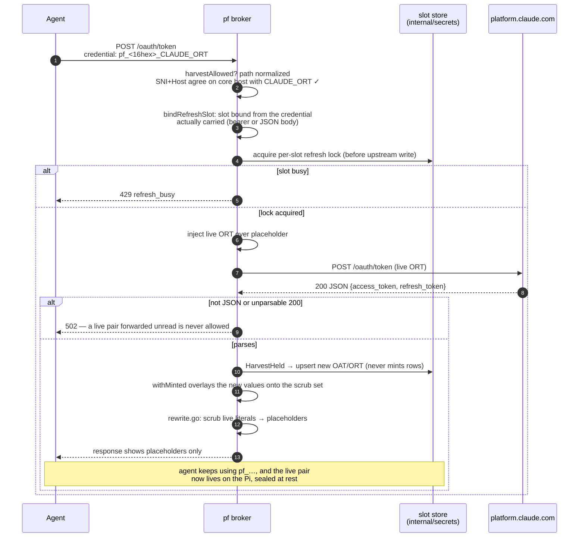
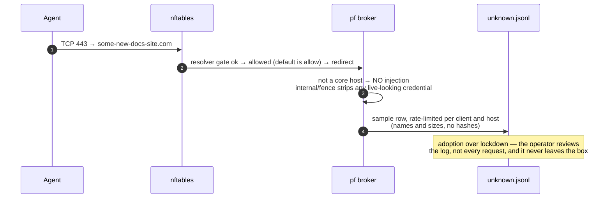
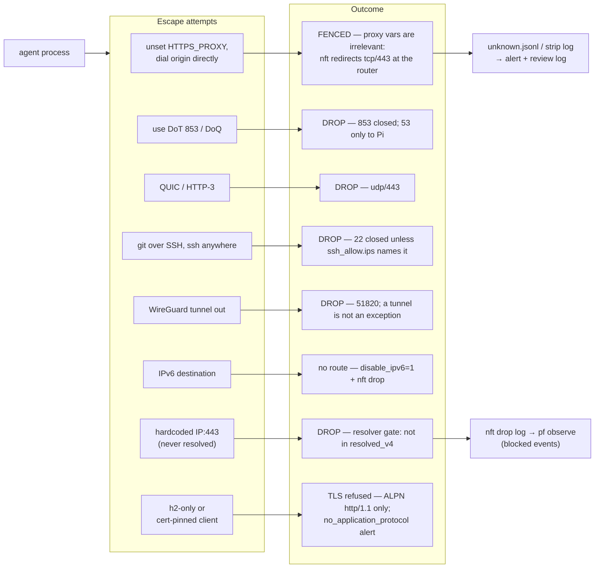
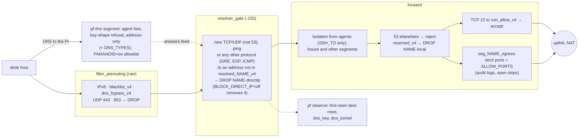

# Flows — what actually happens to a request

These sequence diagrams show real behaviour: how requests flow, how
they are rewritten, and how they are blocked. The conventions are the
same as in [architecture.md](architecture.md):

- Red is a drop or a refusal.
- Amber is observation or review.
- Labels name the real code.

For the concepts, refer to
[../user_guide/tutorials/](../user_guide/tutorials/README.md).

## Flow A — allowed request, credential injected (the happy path)

The agent connects to an approved core host. The placeholder leaves the
agent. The live credential goes to the origin server. The response comes
back scrubbed.

## Flow B — blocked: three layers, all fail closed

## Flow C — DoH escape attempt, caught by signature

## Flow D — OAuth refresh: harvest + scrub

This is the only flow in which the response carries new credentials.
The agent never sees them.

## Flow E — unknown destination: default allow + review log

## Flow F — the agent tries to leave (negative space)

This flow shows all that is not in flows A–E. One diagram is
sufficient, because the behaviour is always the same: **drop, log, move
on**.

Caveat, for the lab only: if `AGENT_BRIDGE` is not set, the VirtualBox
NAT adapter is a userspace path around all of these controls. The
default Vagrant lab is a development topology. It is not an isolation
tier.

## Flow G — a plain segment (the desk)

The gateway filters a plain segment (`segments.d/<name>.env`) as a
machine to which an agent possibly escaped. But the gateway never
terminates it: there is no engine, no broker, and no credential.

NAME below is the file name of the segment. Its resolver feeds
`resolved_NAME_v4` and nothing else. The diagram does not show
SSH_FROM, the one way in.

