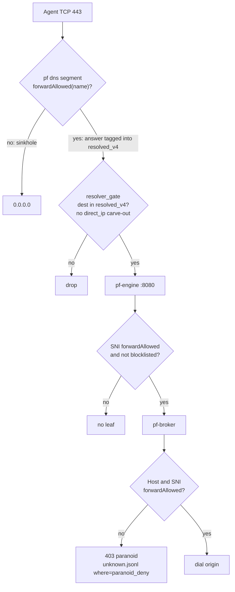

# Paranoid mode: destination allowlists

Paranoid mode is off by default.

To arm paranoid mode, edit one line and run `sudo pf apply`.

Paranoid mode is an opt-in personality on the **agent segment**. This
page describes the agent segment first. Plain segments (the desk) have
their own toggle. That toggle is independent of this one
([Plain segments](#plain-segments)).

- **Off** is the shipping policy of today: the gateway forwards and
  logs an unknown HTTPS host.
- **On**, the gateway refuses an unknown host at four layers:
  1. The agent resolver sinkholes it.
  2. The resolver gate drops the address.
  3. The engine mints no leaf for the SNI.
  4. The broker answers 403 on Host or SNI.

Paranoid mode does not change the house. The escape for a page that
the agent must read is a separate capability. It is not built yet.

## Forward set

`forwardAllowed(name)` is the one oracle for the agent resolver, the
broker, and the engine (`internal/corepolicy/forward.go`). Its rules:

1. `pf-open-echo.test` is always forwarded.
2. `pf-core-echo.test` is forwarded only with `-lab-echo`. It never
   falls through to the lists, even though both policy files name it.
3. Otherwise, a name is forwarded if `HostIn(name, allow.domains)` is
   true, or if the name matches the host column of `core.hosts`. A
   `core.hosts` match is exact, or `*.name` for subdomains only.

The two tables never merge. The older `hostAllowed` of the broker
merges core names into the suffix map. It is kept only to decide what
`unknown.jsonl` logs. As a refuse oracle, it would let the exact core
name `api.x.ai` open `evil.api.x.ai`.

Forward and inject stay separate:

- Forward is the union of the names.
- Inject still uses the `core.hosts` kinds.
- Strip still runs on each forwarded body.

The blocklist runs first and still wins.

`allow.domains` is now operator state (`PI_OWNED`, `admin.AgentLists`).
A listed name covers its subdomains. Thus the seed lists `github.com`,
not `api.github.com`. A `*.name` line in this file is the same as
`name`: it allows `name` itself and each name below it, at all depths.
`pf compile` gives a warning for it: write `name`. `sudo pf tui` writes
a `*.name` that you type as the bare `name`. A line of one label (`com`,
or `*.com`) allows nothing, and `pf compile` gives a warning for it. A
line with a leading dot (`.example.com`), an empty label, a label over 63
bytes or a name over 253 bytes also allows nothing, with a warning. Each
line in this file allows all names below it. There is no form for one
exact name. Write the narrowest name that works, for example
`api.example.com` and not `example.com`.

- With paranoid off, the file only decides which hosts stay out of
  `unknown.jsonl`.
- With paranoid on, this file plus the core host column is all that
  the agent can reach on 443.

## Enforcement map

The map shows `AGENT_DNS=forward`. In fake-IP mode, the gate checks the
pool in place of `resolved_v4`.

A client that skips the Pi resolver still meets the gate, the engine,
and the broker. For that reason, the design rejected a DNS-only
allowlist.

## Pieces

| Piece | Where |
|---|---|
| Flag | `PARANOID=0\|1` in `/etc/pi-fortress/net.env.local`, or in `/etc/pi-fortress/paranoid.env` (`vm/pi/paranoid.env.example`). Apply sources each of the two files only if it is present. Each update replaces `net.env` itself. Apply refuses a value other than `0` or `1`. `--render-nft` reads `PF_PARANOID` |
| Fail closed | Before anything changes, apply runs `test -r` on `allow.domains` and `core.hosts`. `pf broker -paranoid` and `pf engine -paranoid` exit at startup if one of the two files is missing. The ordinary loaders give an empty set for an absent file. That is correct for a log-volume knob, but wrong for the fence |
| DNS | dnsmasq does no DNS on any segment (`port=0`, DHCP only). `pf dns` (`internal/dnsd`) is the resolver for each segment. apply writes one `dns.json`. When `PARANOID=1`, the entry for the agent segment has `"paranoid": true, "allow": "/etc/pi-fortress/allow.domains", "core_hosts": "/etc/pi-fortress/core.hosts"` (plus `"lab_echo": true` in the lab). For each query, the segment checks `forwardAllowed(name)`. This is the same `corepolicy.Forward` oracle that the engine and the broker use to decide. It loads directly from `allow.domains`/`core.hosts`, and is not flattened into directive text. Only the answer for a forward name is tagged into `resolved_v4`. All other names get the sinkhole address. In fake-IP mode (`AGENT_DNS=fakeip`, the default), a forward name gets a pool address, and the gate checks the pool in place of `resolved_v4`. When paranoid is off, the segment has no `paranoid` key and resolves normally. The house segment has no forward set and never had one |
| Gate | `pf render --paranoid` omits ` ip daddr != @direct_ip_v4` from the agent `resolver_gate` line. Thus `direct_ip.allow` cannot skip the forward set. The house gate reads its own `@house_direct_ip_v4`. Paranoid mode does not touch that set. The agent set itself stays. `PARANOID` is written to `apply.env` |
| Engine | `-paranoid -allow FILE -core-hosts FILE -lab-echo`. The engine refuses after the empty-SNI and blocklist checks, before it mints a leaf. It takes the oracle as a local interface. The engine package must not import `corepolicy` (`engine_test.go` asserts this). The engine never sees kinds or secrets |
| Broker | `-paranoid`. No predial for an unlisted SNI. The refuse step runs after `admit` (blocklist, lab-only echo, upgrade, DoH). It runs before the 100-continue, the slot snapshot, and the WebSocket handshake. Unknown WebSockets refuse in the same way |
| Units | apply writes `/etc/pi-fortress/paranoid.flags`. This file always sets the two names `PF_PARANOID_BROKER_FLAGS` and `PF_PARANOID_ENGINE_FLAGS`. Both values are empty when paranoid is off. `pf-broker.service` and `pf-engine.service` read it. `-lab-echo` for the engine comes from `engine.env`, the twin of `broker.env`. A full apply restarts both daemons. `pf apply --local` restarts them when the flags file changed |
| Status | `pf status` prints `paranoid=on\|off`. The `== pf dns ==` section below it runs `pf dns -check`. This prints `paranoid=N` (the number of forward names) for each armed segment |

Why there is no arming probe: `pf`, apply.sh, and the units ship as one
tree. A probe of that tree proves only that the tree agrees with
itself.

## Operator workflow

1. Run a learn week with paranoid off. `unknown.jsonl` and
   `pf observe` show what real sessions reach. Curate `allow.domains`
   in `sudo pf tui`, Agent network → Filtering → Paranoid allowlist.
   - Do not list a subdomain of a listed name.
   - Be careful with one-label or public-suffix names: a listed name
     opens every subdomain.
2. Put `PARANOID=1` in `/etc/pi-fortress/net.env.local` or
   `paranoid.env`. Run `sudo pf apply`.
   The apply line ends with `PARANOID=1`. `pf status` shows the count.
3. Prove it:
   - `example.com` (never_block, not allow) resolves to `0.0.0.0`.
   - The gate drops a `curl --resolve` to its address.
   - An allow name works.
   - open-echo still works in the lab.

   Denials appear in `unknown.jsonl` with `where=paranoid_deny`.
4. Rollback: set `PARANOID=0` and run apply. The off render is the
   golden.

Not listed on purpose: Claude Code telemetry hosts (statsig, sentry).
They fail closed and do not break the client. They show up as
unknowns.

## Tests

| Case | Where |
|---|---|
| Off render byte-identical to `nft.no-house.golden` | `TestNoHouseMatchesGolden`, `apply_test.sh` |
| On: agent gate without `@direct_ip_v4`, house gate with `@house_direct_ip_v4`, set still present; `PARANOID=2` refused | `render_test.go`, `apply_test.sh` |
| Resolver: only the forward set resolves, an unlisted name is sinkholed, an exact core.hosts entry does not carry its descendants (`evil.core.test` sinkholed), missing file while armed is an error | `TestParanoidResolvesOnlyTheForwardSet`, `internal/dnsd/paranoid_test.go` |
| Names: a malformed entry (slash, control byte, over-long label) does not inflate the `paranoid=N` status count and the exclusion never widens the oracle; the shipped seeds resolve to a non-empty set | `internal/corepolicy/forward_test.go` |
| Oracle: `evil.api.x.ai` vs core `api.x.ai`; `api.github.com` via allow `github.com`; core-echo refused without lab, although it is listed; `*.example.com` covers `a.example.com` not `example.com`; missing file errors | `TestForwardAllowed`, `internal/corepolicy/forward_test.go` |
| Broker: SNI miss, Host miss, disagree, unknown WebSocket, listed name forwards, off still forwards, `where=paranoid_deny`, blocklist wins | `internal/broker/paranoid_test.go` |
| Engine: unlisted SNI gets no leaf, listed proceeds, off mints, echo short-circuit | `internal/engine/paranoid_test.go` |
| `allow.domains` editable, bad token refused | `admin_test.go` |
| Plain segment: ruleset byte-identical on, off or absent; agent and segment toggles independent; missing, empty, `*.`-only, unreadable allowlist and `BLOCK_DIRECT_IP=off` refused; the shipped seed renders | `internal/render/paranoid_segment_test.go`, `apply_test.sh` |
| Plain segment resolver: own file only, subdomains, no echo fixtures, blocklist first, own set, missing file refused; the seed answers `api.anthropic.com` and sinkholes `example.com` | `internal/dnsd/paranoid_segment_test.go`, `internal/corepolicy/allow_segment_test.go` |
| Plain segment: dns.json entry through `pf dns -check`; seeding never overwrites | `apply_test.sh` |
| Plain segment: TUI toggle, doctor rung, backup | `segment_paranoid_test.go` (admin, tui), `internal/doctor/paranoid_test.go`, `internal/backup/segment_allow_test.go` |

Not verifiable in the sandbox: unit restarts and `EnvironmentFile`
expansion, live traffic. `pf dns -check` on the armed config runs in
`apply_test.sh`. The other checks run at the first `sudo pf apply` with
`PARANOID=1` on the lab VM.
Block canaries stay `192.0.2.1` / `pi-fortress-block.test`. Never probe
an untrusted host.

## Risks

| Risk | Handling |
|---|---|
| Allow list too tight | Learn week first; default off; instant rollback |
| Suffix widening through core names: an exact `core.hosts` entry that opens its descendants | Separate tables in `Forward.coreListed`. Only `*.name` core entries carry subdomains. Unit tests in `internal/corepolicy/forward_test.go`, and end-to-end tests in `internal/dnsd/paranoid_test.go` |
| Armed with a missing policy file | apply and both daemons refuse to start |
| `pi-ship` wipes the curated list | `PI_OWNED` |
| Skip-resolver client | Gate without the direct_ip carve-out, engine SNI, broker Host |

## Not built: webfetch escape hatch

These decisions are locked for the future build, so that nobody argues
them again:

- The agent never opens an unlisted page itself. An operator or a
  Pi-side sidecar mints a one-shot token. The agent redeems it on a new
  `pf-fetch` unit: HTTP plus bearer on the Pi agent IP, accepted only
  from `AGENT_NET`.
- `pf-fetch` has its own uid. It is in `pf-fortress` but not in
  `pf-fence`. It cannot access the broker directory or the engine CA.
  It has no `CAP_NET_ADMIN` and no `secrets.env`. Its 443 pin exists
  only when paranoid is on. It resolves through the box resolver, not
  the agent segment of `pf dns`. If it used the agent segment, its
  targets would sinkhole.
- Tokens:
  - Ed25519. fetch has the public key only.
  - TTL of 60 s maximum.
  - `jti` burned before the origin GET.
  - URL-bound.
  - No mint fallback in `pf-fetch`.
- The review is a finite checklist:
  - https only.
  - No userinfo or IP literal.
  - Every hop passes `policycompile.Reserved` plus `192.0.2.0/24`.
  - 3 redirects maximum.
  - GET or HEAD.
  - 2 MiB.
  - A text content-type allowlist.
  - No cookies or Authorization forwarded.
  - Strip with `TokenRules.All()` only. Use no rule or value from the broker.

  The envelope says `reviewed: checklist-v1`, `not_a_vuln_scan: true`.
- CLI name: `pf webfetch` or `pf fetchcap`. `pf fetch` is for feeds.

Also not built:

- The TUI toggle on the Paranoid allowlist tab.
- `suggest`: a read-only ranking of learn-week hosts. It warns on
  one-label and public-suffix proposals.

No daemon ever writes `allow.domains`.

## Plain segments

A plain segment (`segments.d/<name>.env`, the desk) arms with its own
key, `PARANOID=on|off`. The default is off. The key is independent of
the agent `PARANOID=0|1` in both directions. All these combinations are
possible:

- Agent on and desk off.
- Agent off and desk on.
- Both.
- Neither.

The segment key accepts `on` or `off` only. `1` is refused. In
`sudo pf tui`, the key is a row in the Settings of the segment.

| Piece | Where |
|---|---|
| Allowlist | `/etc/pi-fortress/allow.<name>.domains`, next to `segments.d`. Same line format and matching as `allow.domains` (`corepolicy.HostIn`). A name covers itself and its subdomains. A `*.name` line is the same as `name`, and a line of one label (`com`, `*.com`), a leading dot, an empty label or a name over the DNS length limits allows nothing (`pf compile` does not read this file and gives no warning for it). Only this file is used: the agent `allow.domains` and `core.hosts` are not read for a segment. The echo fixtures are not forwarded (`corepolicy.LoadAllow`) |
| Seed | apply copies `vm/pi/allow.segment.domains.example` to `allow.<name>.domains` for each plain segment that has no file. It does this once, and never over an existing file. The seed lists `anthropic.com`, `claude.ai`, and `claude.com`. These cover `*.anthropic.com`, `*.claude.ai`, and `*.claude.com`. Thus Claude Code continues to work on a paranoid desk without a first edit. After that, the file is operator state. Edit it by hand and run `sudo pf apply --local` |
| Refusals | With `PARANOID=on`, apply refuses and changes nothing if the file is missing, unreadable, not world-readable (`pf dns` runs as `pf-dns`; `chmod 0644`), or has no usable name. The message names the file. `PARANOID=on` with `BLOCK_DIRECT_IP=off` is refused, because paranoid needs the gate |
| DNS | The `dns.json` entry of the segment gets `"paranoid": true, "allow": "<file>"` and no `core_hosts`. A name that is not on the list gets the sinkhole answer, `0.0.0.0`. The name is logged as `blocked` in `dns-<name>.jsonl`. It is never asked upstream and never put in `resolved_<name>_v4`. The blocklist still answers first |
| Gate | The resolved-address gate of the segment, with no change. The gate drops a new connection to an address that the segment resolver did not give. Paranoid adds no rule of its own. Thus the ruleset is byte-identical with paranoid on or off (`TestParanoidSegmentLeavesTheRulesetAlone`). The gate covers the same things for every plain segment |
| Status | The closing line of apply marks `desk=eth0.79(paranoid)`. `pf status` prints `paranoid (plain segments): desk=on ...`. It also prints `paranoid=on` on the line of the segment, and the allowlist under that line. `pf dns -check` prints `paranoid=N` on the line of the segment. `pf doctor` has a `paranoid` rung for each armed segment. The rung shows FAIL when the file is missing or empty |
| Backup | `pf backup` carries `allow.<name>.domains` next to its segment file |

Compared with the agent, a paranoid segment does not get fake-IP. Without
`INSPECT=on`, it also does not get:

- An engine or broker refusal.
- An SNI or Host check.
- TLS inspection.

With `INSPECT=on`, the segment gets the engine and the broker. They do not
use the forward set of the agent for it. Its own allowlist is in its resolver.

DNS and the gate are its only two layers. Armed or not, its DNS
already refuses key-shaped names and answers with addresses only.

Known limits:

- An allowlisted name on a shared CDN address opens that address to
  anything else served from it. This lasts for the timeout of the set
  (2 h).
- Arming does not close what is already open. Connections in conntrack
  continue to run. Addresses already in `resolved_<name>_v4` stay open
  until they time out.
- Some clients reach an address without a query to the Pi (a literal
  IP in config). The gate stops such a client on any port, and on any
  other IP protocol (GRE, ESP, SCTP, ICMP other than echo). But it does
  this only while `BLOCK_DIRECT_IP` is on. Paranoid requires
  `BLOCK_DIRECT_IP` on. The gate covers every protocol, whatever
  `EGRESS` says. Thus `EGRESS=open` or `audit` widens ports to resolved
  addresses only.
- When `pf dns` starts, it answers `REFUSED` to everything for these
  segments, and logs it:
  - A paranoid segment whose file is gone.
  - Any house or plain segment whose files do not load.

  The agent, the house, and the other segments start normally.
  - The next `pf apply` re-seeds a deleted file.
  - A SIGHUP reload serves the segment again after its files load.
  - `pf doctor` reports the gap (its `pf dns -check` stays strict).

  The listener of the agent itself and the loopback stub of the box are
  never isolated. If one of them fails, `pf dns` stops.

## References

`docs/risk_model.md` §2.1, §7; `docs/fence.md` §5.2, §5.4;
`docs/privilege_split.md`; `internal/corepolicy/forward.go`;
`internal/dnsd/dnsd.go`; `internal/broker/serve.go` `paranoidRefuse`;
`internal/engine/engine.go`; `internal/render/ruleset.go` `DirectCarve`;
`vm/pi/apply.sh`; `vm/policy/allow.domains`.
