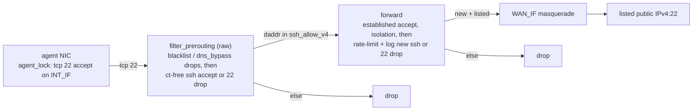

# Agent SSH allowlist

`vm/policy/ssh_allow.ips` lists the **public** IPv4 addresses or CIDRs
that the agent segment can reach on TCP 22. Each entry is `/16` or
narrower, and is written as the network itself. The list is empty by
default. An empty list gives the ruleset of today, byte for byte.

- The operator edits the list in `sudo pf tui` (Agent network →
  Filtering).
- `pf compile` coalesces the list. It skips a line that:
  - Is not a public address (a hostname, a private address).
  - Is wider than `/16`.
  - Has host bits (`140.82.114.4/20`; write `140.82.112.0/20` or the
    one address).

  For a skipped line, the output of `pf apply` has a
  `compile: warning:` line that names the file and the line.
- `pf render` punches one narrow accept above the existing TCP 22
  drops.

The same list gives the SSH destinations of every plain segment (the
desk; see [Plain segments](#plain-segments)). The resolver gate of a
plain segment gets one accept for TCP 22 to the list. Nothing else
changes: not the fence, not the house.

## Read first: SSH bypasses the fence

On 22, there is no TLS termination, no placeholder injection, and no
strip. A listed destination is two things at the same time:

1. A **stolen-credential path**. Any key, `ssh-agent` socket, or
   scripted password that the agent holds can be used toward that
   address.
2. An **unfiltered tunnel**. After the session starts,
   `ssh -D/-L/-R/-W`, `ProxyJump`, and `ssh host 'curl …'` skip these
   controls:
   - `resolver_gate`.
   - The domain lists.
   - The QUIC drop.
   - Strip.
   - Conversation DLP.

   No data about the tunnel gets to the strip or alert logs.

When the operator lists an address, the operator accepts both. Prefer a
forge SSH front door to a jump box that you administer. Git should
continue to use HTTPS through the fence. This list is for the case
where TCP 22 is the only path. Forge SSH addresses rotate. Thus paste
the current answers yourself. Nothing fetches `api.github.com/meta`.

## Data path



## Pieces

| Piece | Where |
|---|---|
| List | `vm/policy/ssh_allow.ips`. It is `PI_OWNED` in the Makefile. Thus `make pi-ship` never overwrites the copy on the Pi |
| TUI | `admin.AgentLists` has `ssh_allow.ips`, kind `ssh_ips`. Tokens go through `policycompile.ParseSSHIPv4`, the same parser that compile uses. Thus Reserved space (RFC1918, TEST-NET-2/3, `0.0.0.0/0`) is refused. A prefix with host bits is refused, not masked. A public prefix down to `/16` is accepted. This is the floor of an allow list, as `/24` is for `direct_ip.allow`. The floor is `/16` because forges publish their SSH front doors as ranges that wide (GitHub's `140.82.112.0/20`) |
| Compile | `pf compile --out-ssh-nft FILE`: `LoadTokens` → `CoalesceIPv4` → `nftElements`. `Summary.Line()` adds `N ssh_allows` only when the count is not zero |
| Render | `pf render --ssh-elements FILE`. `sshAllow()` in `internal/render/ruleset.go` sets three fragments (set, raw accept, forward accept) only when the elements are not empty. Each fragment starts with a newline. Each fragment is appended to the end of an existing rule line. Thus an empty list does not change `vm/pi/testdata/nft.no-house.golden` |
| apply.sh | Passes the compiled file through. `--render-nft` takes `PF_SSH_ELEMENTS` inline |
| Agent lock | `vm/agent/routes.sh` and `vm/agent/setup.sh` accept TCP 22 toward `INT_IF` after the `oifname != INT_IF` drop. The early 22 drop is gone. The destination policy is only on the Pi. Thus TUI edits never need a sync on the agent side |
| Status | `pf status` prints `ssh_allow.ips: N prefixes` or `(no set)`. The prerouting/forward greps include `dport 22` |

## The rules

These rules are rendered only when the list is not empty:

```nft
set ssh_allow_v4 {
  type ipv4_addr
  flags interval
  elements = { ... }
}

# filter_prerouting (priority raw), immediately above the existing drop
iifname "INT_IF" tcp dport 22 ip daddr @ssh_allow_v4 accept
iifname "INT_IF" tcp dport 22 counter drop

# forward, after the established accept and the isolation drops,
# immediately above the existing drop
iifname "INT_IF" tcp dport 22 ip daddr @ssh_allow_v4 ct state new limit rate 30/minute burst 60 packets log prefix "pi-fortress ssh-allow: " level info counter accept
iifname "INT_IF" tcp dport 22 counter drop
```

Why this shape:

- **Both hooks need the match.** `accept` in prerouting only ends that
  chain. The policy drop of forward would still kill the flow.
- **The raw accept is ct-free.** Priority raw runs before conntrack.
  Thus `ct state new` is never true there. Also, a per-packet rate limit
  would cut an interactive session at the burst. The rate limit, log,
  and counter are in forward, after
  `ct state established,related accept`. Thus only new flows pay. A
  `-150` chain instead of the raw accept would not work either: the
  raw 22 drop wins first.
- **Destination drops still win.** `@blacklist_v4` and `@dns_bypass_v4`
  stay above the accept in prerouting. `192.0.2.1` is on the blacklist
  seed. Thus, if you list it, nothing changes.
- **Addresses, not names.** With `AGENT_DNS=fakeip`, a name that the
  agent resolves gets a pool address. A pool address is never in
  `@ssh_allow_v4`. Thus SSH to a listed host works by its address only
  (`fence.md`, Fake-IP). The raw 22 drop does not take the pool. The
  first forward rule after the conntrack verdicts rejects TCP 22 to the
  pool with a TCP reset. Thus SSH to a name fails immediately. In
  forward mode, a name works because it resolves to the real, listed address.
- **Never `input`.** The agent segment cannot SSH to the Pi. The house
  `HOUSE_ADMIN_IP` and the plain-segment `SSH_TO` open the other
  direction. They are not changed.
- **One budget per agent segment.** 30/minute burst 60 is the same as
  for WAN SSH. All listed destinations share this budget.

## Operator workflow

1. In `sudo pf tui`, go to Agent network → Filtering → SSH destinations
   (`ssh_allow.ips`). Add a public address or CIDR.
   - Do not use `203.0.113.10` (TEST-NET-3, refused).
   - Do not use `192.0.2.1` (the blacklist drop wins).
2. Select Actions → apply. The first time after this change, also
   reload the agent lock one time (`routes.sh` / `setup.sh` / the
   `pi-fortress-agent-lock` oneshot, or reboot). `pf apply` does not
   touch the agent box. Later list edits need only apply.
3. From the agent, run `ssh user@<ip>`, or use a git+ssh remote by
   address.
4. `pf status` shows the prefix count. The journal shows
   `pi-fortress ssh-allow:` for each new flow. The forward counter
   increases.

To close the hole, clear the list and apply. The set and both accepts
disappear.

## Plain segments

The gateway treats a plain segment (`segments.d/<name>.env`, the desk)
as a machine to which an agent possibly escaped. Thus the segment reads
the same list, not a second list. When the list is not empty, the
forward chain of the segment has this rule. The rule is after its
`@reserved_v4` drop and before its port policy:

```nft
iifname "<seg IF>" tcp dport 22 ip daddr @ssh_allow_v4 ct state new counter accept
```

- With `EGRESS=strict` (the default), port 22 is not in the strict set.
  Thus this accept is the only way for SSH to leave the segment, unless
  `ALLOW_PORTS` names `tcp:22`. `EGRESS=audit` and `open` let 22 out to
  any address that the segment can reach.
- The resolved-address gate of the segment lets TCP 22 to a listed
  address through, before its drops. Thus SSH to a listed address works
  also when the resolver of the segment did not give that address, and
  `BLOCK_DIRECT_IP=off` is not necessary. Other ports to a listed
  address still meet the gate. The blacklist and the `@reserved_v4`
  drop still apply. A plain segment has no fake-IP. Thus names work.
- The rule has no rate limit or log line of its own. The connection
  budget of the segment applies.
- `SSH_TO` (out to the agents) and `SSH_FROM` (one address in) are
  separate holes. They do not read this list. `SSH_FROM` arrives only
  on the house interface or on the interface of another plain segment.
  Each of these has a source check. `SSH_FROM` never arrives on the
  uplink, the agent network, or the tunnel (`WG_IF`).

## Tests

| Check | Where |
|---|---|
| Empty list renders byte-identical to `nft.no-house.golden` | `TestNoHouseMatchesGolden`, `apply_test.sh` golden diff |
| Non-empty: set with `flags interval`; prerouting order blacklist < dns_bypass < accept < 22 drop; no `ct` at raw; forward accept after the established accept and immediately above the 22 drop; no `input` 22 on `INT_IF` | `TestSSHAllowAcceptsSitAboveTheTCP22Drops`, `apply_test.sh` |
| House + desk holes unchanged; isolation drop precedes the ssh forward accept | `TestSSHAllowLeavesTheHouseAndDeskHolesAlone`, `apply_test.sh` |
| Coalesce, absent file is empty, summary line | `TestIPAllowLists` (`ssh_allow`, `ssh_allow absent`) |
| Token validation: bad token, RFC1918, public `/22` and host | `TestSSHAllowListEdit` |
| `/16` floor, host bits refused, skipped lines warned by number | `TestParseSSHIPv4`, `TestSSHAllowSkipsWideAndHostBitPrefixesByLine`, `FuzzParseSSHIPv4` |
| Both agent-lock copies accept 22 and neither has the early drop | `apply_test.sh` |
| `github.com:22` from the agent still blocked with the list empty | `vm/itest/policy_test.go`. Keep it as the empty-list regression. Do not paste GitHub ranges into the list while it runs |

Soak on the lab:

1. Paste one listable public address.
2. Apply.
3. Reload the agent lock one time.
4. Confirm the journal prefix and the forward counter.
5. Clear the list.
6. Apply.
7. Confirm that the set is gone.

Never SSH to an untrusted host. Block canaries stay `192.0.2.1` /
`pi-fortress-block.test`.

## Risks

| Risk | Handling |
|---|---|
| Listed address plus an agent-held key | Accepted. Empty default, RoleAdmin edit, this page |
| Session used as a tunnel past the fence and DLP | Accepted. Same, and prefer non-shell destinations |
| Operator pastes a whole forge range | Allowed down to `/16`. A wider entry is skipped with a warning. `pf status` shows the count |
| Confusion with `HOUSE_ADMIN_IP` / `SSH_TO` | Separate file, separate set, egress-only rules, no `input` hole |
| Second agent uplink | `oifname != INT_IF` drop in the agent lock is unchanged |
| Golden drift from an empty list | Fragments are omitted, not blanked; both test harnesses diff the golden |

## Not in v1

- Domains, SNI, or forge meta feeds.
- Ports other than 22.
- IPv6.
- RFC1918 destinations. These would need a second parser (a later PR,
  if product asks).
- Any fence or strip on SSH.

## References

`docs/risk_model.md` §2.1; `docs/fence.md` §5.2; `internal/render/ruleset.go`;
`internal/policycompile/compile.go`; `internal/admin/lists.go`;
`vm/agent/routes.sh`, `vm/agent/setup.sh`; `vm/pi/apply_test.sh`;
`docs/user_guide/home_network.md` for the other-direction SSH holes.
