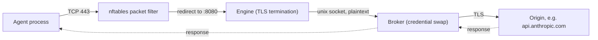
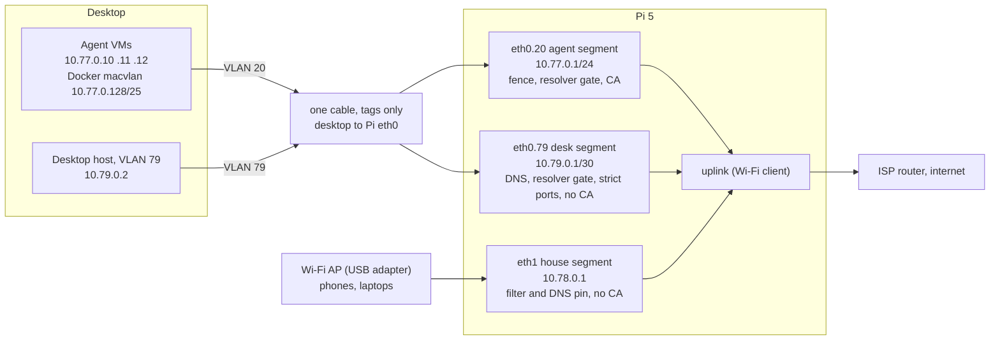
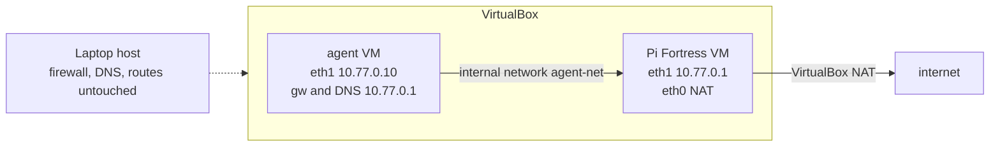
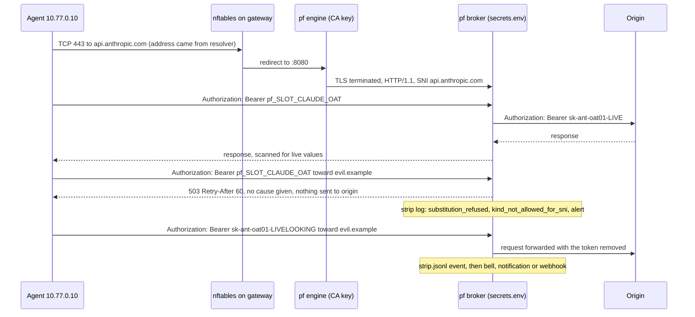

<!-- How a request flows through Pi Fortress, what each enforcement layer does, and the Pi and lab topologies. -->
# Architecture

Pi Fortress is a gateway between your coding agent and the internet. All requests from the agent go through the gateway. The gateway examines each request. For an approved origin server, the gateway replaces the placeholder credential with the live credential.

This page:

- Shows the path of one request.
- Lists the layers that enforce this path.
- Shows the network layout on a Raspberry Pi and in the test lab.

## Terms

| Term | Meaning |
|---|---|
| Agent | The coding agent process. It runs in a VM or a container. |
| Gateway | The Pi Fortress machine: a Raspberry Pi, or a VM in the lab. |
| Origin server | The server that the agent sends a request to, for example `api.anthropic.com`. |
| Resolver | The DNS service that changes a host name into an IP address. |
| SNI | Server Name Indication. The host name in the ClientHello, the first message of a TLS handshake. The SNI is not encrypted. |
| CA | Certificate authority. The gateway has its own CA. The CA signs the certificates that the engine gives to the agent. |
| Placeholder | A fake credential value that the agent has, for example `pf_SLOT_CLAUDE_OAT`. |
| Live credential | The real value of a credential. Only the broker can read it. |
| Live-looking token | A value in a request that has the format of a real credential. |
| Strip | Remove a live-looking token from a request. The request then continues without the token. |
| Core host | A host in `core.hosts`. The gateway manages credentials for these hosts. |
| Non-core host | A host that is not in `core.hosts`. |

## One request, end to end

These steps show what occurs when an agent sends one HTTPS request.

1. **DNS.** The agent resolves a host name, for example `api.anthropic.com`. The DNS query goes to the gateway, because the gateway is the only resolver for the agent. The gateway drops DNS traffic (port 53) to all other servers.
    - In the default mode (`AGENT_DNS=fakeip`), the gateway does not send the query to a different server. It gives a stand-in address from a private range (`198.18.0.0/16`). Each name gets one stand-in address. The gateway resolves the real name only at step 6, after the TLS handshake gives the host name.
    - In forward mode (`AGENT_DNS=forward`), the gateway gives the real address to the agent.

    The agent then opens a connection on TCP port 443 (HTTPS) to that address.

2. **Packet filter.** The gateway packet filter examines each packet when it arrives, before routing.
    - First, it drops packets to blocklisted addresses.
    - Then it examines each new TCP 443 connection. The address must come from the gateway resolver. In fake-IP mode, this is a stand-in address. In forward mode, this is a real address that the resolver gave in the last two hours.
    - It drops all other connections.

3. **Engine.** nftables (the Linux firewall) sends the connection to the **engine** on port 8080. The engine reads the SNI from the ClientHello. Then the engine:
    - Refuses a blocklisted SNI.
    - Makes a short-term certificate for that name. The gateway CA signs this certificate.
    - Terminates TLS. This means that the engine decrypts the connection from the agent. The broker opens a new encrypted connection at step 6.
    - Uses HTTP/1.1 only.

4. **Broker checks.** The engine sends the decrypted HTTP/1.1 stream to the **broker** through a unix socket. A unix socket is a local channel between two processes on the same machine. The broker then:
    - Compares the HTTP `Host` header with the SNI. They must be the same.
    - Examines the blocklist again, by name.
    - Searches `core.hosts` for the host. This file lists the providers for which the gateway manages credentials.

5. **Credential fence.** The broker applies the rules for the type of host.

    **For a core host:**

    - The broker replaces a placeholder with its live credential only if the host accepts that kind of placeholder.
    - The broker does the replacement only in the credential headers for that kind. These are `Authorization`, `X-Api-Key`, and each header that you declare for that host and kind ([Pi setup](pi_setup.md#headers-a-credential-may-go-in)).
    - Exception: the Claude refresh token goes in the body of the refresh request. It goes only in the `refresh_token` value.
    - The broker refuses the same placeholder in all other locations: other headers (`Host` and `Connection` also), the URL, and all other parts of the body. Reason: a server can echo the body back, publish it, or make a model print it in a changed form.
    - The broker refuses the full request if the placeholder is of the wrong kind for the host, is unknown, or is quarantined. The agent gets one `503` response. The response does not give the cause.
    - The broker strips a live-looking token for a different provider.

    **For a non-core host:**

    - The broker never replaces a placeholder.
    - The broker strips all live-looking tokens.

6. **Origin connection.** The broker opens its own TLS connection to the origin server.
    - In fake-IP mode, the broker first resolves the name itself, through the gateway. It compares the address with the blocklist and with the private ranges.
    - The broker compares the certificate of the origin server with the SNI.
    - The broker sends the request over HTTP/1.1. It asks only for gzip compression. The response is then in gzip format or not compressed.
    - The broker decompresses the response and scans it for all live credential values. If it finds a value, it replaces the value with its placeholder and logs an incident.
    - The broker sends the response to the agent.
    - The broker does not scan a response with a different compression. If the request had a substituted credential, the broker refuses that response with `502`. If not, the broker sends the response to the agent without a change. Refer to **Limits of the design**, below.

7. **Logs and alerts.**
    - Each stripped token writes one line to `strip.jsonl`.
    - Each request to an unknown origin server writes one line to `unknown.jsonl`.
    - A separate sidecar process (`pf alert`) reads the strip events. It sends a webhook call, if you configure a webhook. `pf alert watch` also shows each event in a terminal. The request does not wait for this alert.

**Location of secrets.** The design keeps each secret in a different process. This limits the damage from one security flaw.

- The CA private key is on the gateway. Only the engine user account can read it. The agent trusts only the public certificate of the CA.
- The live credentials are in `secrets.env` on the gateway. Only the broker user account can read this file.
- The engine cannot read `secrets.env`. The broker never has the CA key. The TLS parser receives data directly from the untrusted agent. But a bug in the TLS parser cannot give live credentials to an attacker.
- **Limit:** this design limits what one flaw gives. It does not limit what the agent can reach. The engine sends the decrypted stream from the agent directly to the broker. The broker HTTP parser runs in the process that *has* `secrets.env`. All clients that complete a TLS handshake with the gateway can reach that parser. They do not need a credential.

## Enforcement layers

Each layer does one job. Together, the layers control DNS, addresses, names, TLS, credentials, and logs.

| Layer | Function | Effect |
|---|---|---|
| Agent lockdown (`setup.sh`) | Firewall rules on the agent machine. Only DNS, the CA download, ping to the gateway, TCP 443, and TCP 22 can go out, and only on the cable to the gateway. The gateway lets TCP 22 through only to the addresses in `ssh_allow.ips`. IPv6 and Wi-Fi are off. | Stops accidental side channels. It does not stop a user with root access on the agent. That user can remove the rules, but has no other cable. |
| Resolver pin | The gateway drops DNS (port 53) to all other servers. It drops DNS over TLS (port 853) and QUIC (UDP 443, for HTTP/3). It sinkholes the addresses of known DNS-over-HTTPS (DoH) resolvers. You cannot override this. It refuses a DNS query if the name has a live-looking key or a placeholder. It does not forward that query, and it sends an alert. The agent gets only address records. Other record types come back empty. An alias chain comes back as its end addresses, maximum 16. To let a name use a different record type, for example SRV, add a line in `sudo pf tui`, **Agent network → Filtering → DNS record types**. The TUI refuses a type with an incorrect spelling. | Stops DoH and QUIC that send DNS around the gateway. Stops a key that is hidden in a DNS name. Stops text that comes back in DNS answers, for example an LLM that answers through TXT records. |
| Blocklist, by name | The gateway resolver sinkholes listed names and their subdomains. The engine refuses a listed SNI. The broker refuses a listed `Host` header. | Uses these feeds: URLhaus (live fetch), Spamhaus DROP, Feodo Tracker, Phishing Army. Also uses the names that you add. A small `never_block` list overrides the feeds. |
| Blocklist, by address | An nftables set. The gateway examines it when packets arrive, before routing. In fake-IP mode, it also examines the connections that the broker opens. The gateway drops matches silently. It does not send a reject. | Stops listed IPs and IP ranges. Also stops the canary test address `192.0.2.1`. |
| Resolver gate | The gateway drops a new TCP 443 connection to an address that its resolver did not give. | Stops a direct connection to an IP address, an SNI that is an IP address, and an SDK with a hard-coded address. |
| TLS engine | Terminates TLS transparently. Uses HTTP/1.1 only. Accepts only TLS 1.2 or newer. | Lets the broker examine the request. A client that uses only HTTP/2 fails here. A client that pins its own certificate also fails here. |
| Credential fence | Replaces placeholders with live credentials. The match uses the kind and the origin host name. Refuses requests that are not approved, with one standard response. Strips live-looking tokens. Captures OAuth refresh tokens. Scrubs WebSocket frames. | Stops a token that goes to a third party. Stops the key of the wrong provider in a request that is otherwise approved. |
| Review log | Each request to an unknown origin server writes a log row. The log never has bodies. From the headers, it logs only the header names, a shortened `User-Agent` and `Content-Type`, the `Authorization` scheme, and the cookie names. It has no hashes and no TLS client fingerprints. | Shows where a new tool connects. It does not block the tool. |
| Segment isolation | The agent, desk, and house segments cannot reach each other. The only exceptions are SSH paths that you configure: from a reserved house admin device to the gateway and the agent; from a desk to the agent VMs that its file names; and from one address that you select into the desk. This last path is one-way. Only the agent segment can reach the engine or the CA server. | Stops a compromised agent that tries to reach your desktop or the devices of your family. |

The same firewall also controls the background services (daemons) of the gateway. To manage the gateway, use `sudo pf tui` over SSH or at the gateway. No management service listens on the network.

## Topology: Pi 5

This is a typical layout:

- One cable connects the desktop to the Pi. The cable carries two VLANs. A VLAN is a logical network on a shared cable. A tag identifies each VLAN.
- The Pi `eth0` port has no IP address. It carries only the tagged VLANs.
- A USB Ethernet adapter on the Pi connects to the house network, through a Wi-Fi access point.
- The Pi connects to the internet over Wi-Fi, as a client of the ISP router. A wired uplink needs one more adapter.

**Desk segment.** The desk segment has your everyday desktop. The agent VMs also run on this desktop. Thus Pi Fortress assumes that an agent can escape to the desktop. The desk segment gets:

- NAT (network address translation). NAT lets the desktop use the Pi uplink.
- Segment isolation.
- A DNS resolver. `pf dns` answers on the desk segment address. It uses the same sinkhole lists as the agent segment.
- A resolver gate on all ports. A new connection opens only to an address that the resolver gave recently.
- Drops for QUIC, DNS over TLS, and local addresses.
- The same strict set of ports as the house segment.

By default, the desk segment has no CA and no TLS inspection. The address blocklist drops listed IPs, as on all segments. With `INSPECT=on`, the gateway sends the TCP 443 of the desk to the engine, on the desk address. The broker also serves the desk subnet. Thus the desk gets the credential fence of the agent VMs ([FAQ](faq.md#desk-tls-inspection)). The paranoid mode and the fake-IP of the agent network do not apply to it.

**House segment.** The gateway also filters the house segment. It uses the same feeds, a DNS pin, and drops for DoH and QUIC. It does not do TLS inspection. Only the agent segment, and a desk with `INSPECT=on`, have the credential fence.

**Desktop forwarding.** The desktop must not forward traffic for the agent VMs. The desk setup script disables forwarding and locks the agent VLAN on the desktop. Thus, if you connect a Wi-Fi adapter to the desktop later, the agents cannot use it to go around the Pi.

The traffic of the desktop itself is a different problem. The only uplink of the desktop must be the Pi. The lock step refuses a desktop that has one of these:

- Wi-Fi that is on.
- A different default route.
- A different wired port with a route.

## Topology: Vagrant lab

The agent VM has a VirtualBox NAT adapter. This adapter is only for the first setup. The approved SSH path goes through the gateway in bridged mode. In other modes, it goes through a host-only management network interface (NIC). When SSH answers on the approved path, VirtualBox disconnects the NAT adapter. The adapter stays connected only until this path works.

The lab gateway also runs a core echo service (`pf-core-echo.test`). The tests use this service. A real Pi does not need it.

## One request substituted, one refused, one stripped

This sequence shows three results for the same type of request:

1. The gateway replaces the placeholder with a live credential.
2. The gateway refuses the request.
3. The gateway strips a live token that must not be in the request.

The broker refuses a placeholder in a location where its kind is not approved. The broker strips a live-looking token to a non-core host. The request then continues without the token.

## Limits of the design

- **HTTP/1.1 only.** The broker parser does not read HTTP/2 framing. A client that offers only HTTP/2 (`h2`) fails the TLS handshake. The gateway drops HTTP/3, because HTTP/3 uses UDP port 443.
- **IPv4 only.** IPv6 is off on the agent. The gateway denies IPv6.
- **No certificate pinning.** A client that pins its own certificate fails. To prevent this, set the client to trust the gateway CA.
- **The broker streams large or chunked request bodies. It does not buffer them.** This applies to a body larger than 1 MiB, and to a body with chunked transfer encoding. The broker sends the request headers before it reads all of the body. Thus:
    - The broker never replaces placeholders in a streamed body.
    - If a streamed body has a placeholder, the gateway stops the connection to the origin server before the request completes. The log entry is `placeholder_in_streamed_body`.
- **Foreign live tokens in a streamed body.** The detection rules are the same as for a buffered body. In the two cases, the broker finds a match only in a 4096-byte window.
- **Responses with `br` (Brotli) or `zstd` compression.** The scrub cannot read these responses. If the request had no substituted credential, the broker sends the response without a change and logs it. If the request had a substituted credential, the gateway refuses the response with `502`. Reason: the response can contain a live value.
- **WebSocket frames.** The broker scrubs frames for live tokens. It never replaces placeholders in frames.
