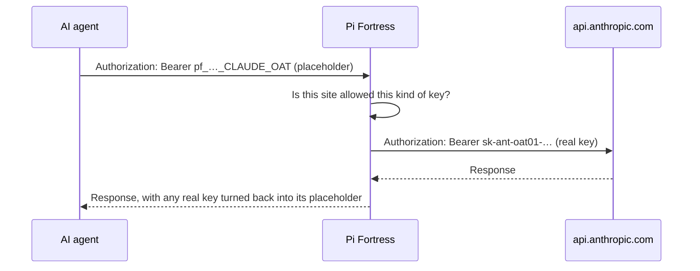
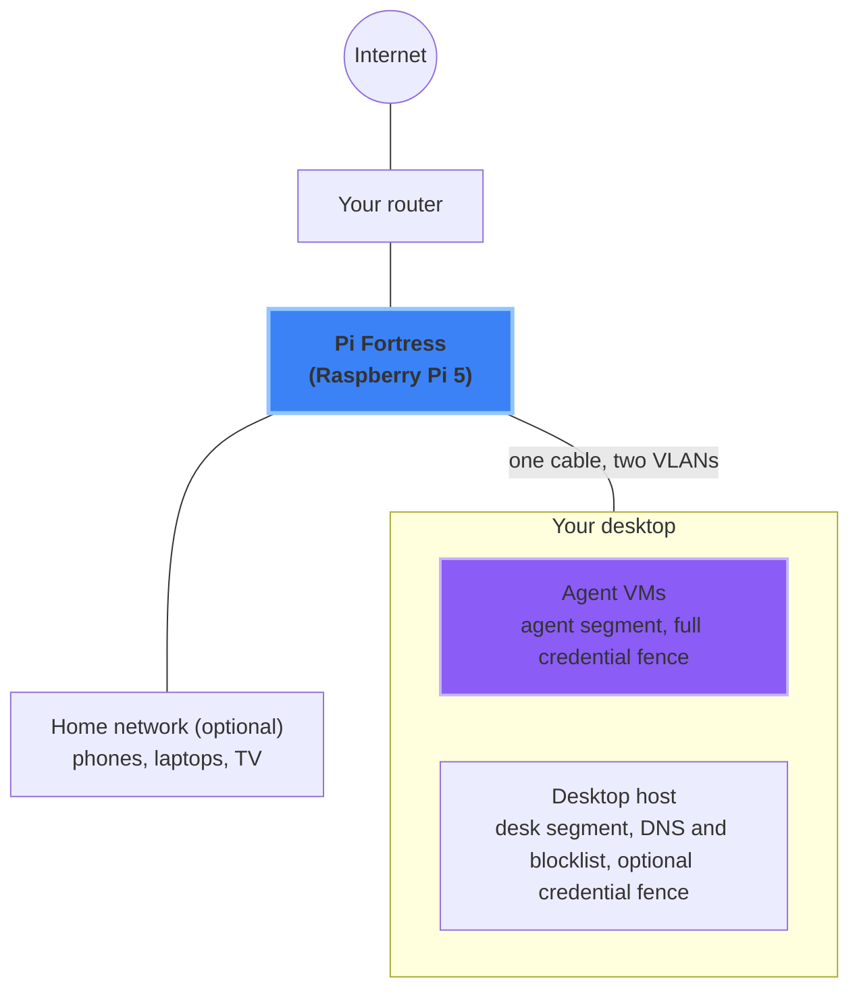

<!-- Home page of the public user guide: what Pi Fortress is, in pictures first. -->
<div class="pf-hero" markdown>

{ .pf-hero-logo }

# Pi Fortress

</div>

!!! info "Open evaluation"
    Pi Fortress is open for evaluation. One command starts the full system in a cloud lab: the gateway, an agent with a placeholder key, and the end-to-end test suite. The same suite runs on a real Raspberry Pi 5. Use test keys, or keys with a spend limit, while you evaluate. The source is open under Apache-2.0.

**A small box between your AI agent and the internet. With it, the agent never holds your real API keys.**

AI coding agents need API keys to work. A malicious prompt, a bad skill or an MCP server can trick an agent. A tricked agent can send those keys anywhere. Pi Fortress removes the keys from the agent machine and fences them at the network. The agent sees only fake placeholder keys. The gateway puts in the real key only when the request goes to a service that the key belongs to.

It runs on a Raspberry Pi 5, or on a [small VM](getting_started.md#gateway-on-a-debian-or-ubuntu-vm) next to the VM of the agent. The agent cannot disable it, because it does not run on the agent machine.

How is it different from a proxy, a vault or a sandbox? Refer to the [comparison](comparison.md).

## Try it now

### In a cloud lab, with no Pi

Run the full setup as VMs on one cloud machine: the gateway, an agent with a placeholder key, and the end-to-end tests. You need:

- Ubuntu 24.04 on amd64, with nested virtualization on. On GCP, an `n2-standard-4` VM with `--enable-nested-virtualization` is sufficient.
- 8 GB RAM (16 GB is better) and 100 GB of disk.
- A machine that you can give to the lab. The lab makes its own networks on the machine.

Log in to the machine and run this command:
```
curl -fsSL https://raw.githubusercontent.com/nrnjn42/pi-fortress/main/install-lab.sh | sudo bash
```

The command clones the source and installs the lab. It enrols one agent and runs a smoke test. Then it shows the next steps. Continue with [Getting started](getting_started.md), step 2.

To read the script before it runs:
```
curl -fsSLO https://raw.githubusercontent.com/nrnjn42/pi-fortress/main/install-lab.sh
less install-lab.sh
sudo bash install-lab.sh
```

### On a Raspberry Pi 5

You need a Raspberry Pi 5 with Raspberry Pi OS Lite 64-bit, and a machine for the agent ([full list](pi_setup.md)). In Raspberry Pi Imager, turn on SSH and set the Wi-Fi. Connect to the Pi with SSH over Wi-Fi, and run this command:
```
curl -fsSL https://raw.githubusercontent.com/nrnjn42/pi-fortress/main/install.sh | sudo bash
```

The command installs the newest signed release and verifies each download. It asks which port is the uplink and which port is for the agent. It refuses to give the agent the port of your SSH session. Continue with [Getting started](getting_started.md), step 2.

## Why it exists

AI agents hold keys, and attackers hunt them. Flaws, VM escapes included, are found faster every year.

<div class="pf-charts">
<div class="pf-chart" data-title="CVEs published per year" data-unit="thousand" data-labels="2019,2020,2021,2022,2023,2024,2025" data-values="17.3,18.3,20.1,25.1,28.8,40.0,48.2"><p>CVEs published per year</p><ul><li>2019: 17.3 thousand</li><li>2020: 18.3 thousand</li><li>2021: 20.1 thousand</li><li>2022: 25.1 thousand</li><li>2023: 28.8 thousand</li><li>2024: 40.0 thousand</li><li>2025: 48.2 thousand</li></ul></div>
<div class="pf-chart" data-title="Secrets leaked on public GitHub" data-unit="million" data-labels="2022,2023,2024,2025" data-values="10.0,12.8,23.8,29.0"><p>Secrets leaked on public GitHub</p><ul><li>2022: 10.0 million</li><li>2023: 12.8 million</li><li>2024: 23.8 million</li><li>2025: 29.0 million</li></ul></div>
</div>

| When | Incident |
|---|---|
| Mar 2025 | **VMware ESXi:** three zero-days that escape a VM to the hypervisor, used in real attacks |
| Aug 2025 | **s1ngularity:** npm malware told AI coding tools to search for keys. 2,349 secrets leaked |
| Nov 2025 | **Shai-Hulud 2.0:** npm worm. About 400,000 secrets exposed |
| Apr 2026 | **Claude Mythos Preview:** found and exploited zero-days in every major OS and browser, and a guest-to-host flaw in a production hypervisor |
| Sep 2026 | **Mandiant:** a hijacked AI coding session stole GitHub tokens. About 100 repositories infected |
| Sep 2026 | **Google:** an AI attack framework took thousands of credentials in less than six hours |

Pi Fortress assumes that the agent can escape its VM. Thus the keys are on a separate box. [Sources](why.md)

## How it works

<div class="pf-flow">
<ol class="pf-flow-steps">
<li>The agent sends a placeholder. It never holds the real key.</li>
<li>For the service that owns the key, Pi Fortress puts in the real key.</li>
<li>A hijacked agent sends the placeholder to a different server.</li>
<li>Pi Fortress refuses the request and alerts you.</li>
</ol>
</div>

All requests from the agent go through Pi Fortress. The agent has no proxy setting to bypass.

- **To the right service:** Pi Fortress replaces the placeholder with the real key, only in a credential header. A credential header is `Authorization`, `X-Api-Key`, or a header that you declare for that service. If the placeholder is in a different location, Pi Fortress refuses the request.
- **To anywhere else:** Pi Fortress never replaces the placeholder. It strips a live key in a format that the gateway knows (Anthropic, OpenAI, GitHub, AWS, GitLab, npm and more). It strips the key from header values, the URL and the body.
- **To a known-malicious site:** Pi Fortress drops the connection.

## One request, step by step



If the check fails, the agent gets one plain refusal. The refusal does not give the cause. The owner gets an alert.

## Where it sits in your network



Your desktop and its agent VMs use one cable to the Pi. The Pi is the only uplink of the desktop. Pi Fortress assumes that an agent can escape its VM. Thus the desktop also gets DNS filtering and the blocklist.

The same box can also filter your home network. It blocks known-bad sites for phones and laptops.

## What you get

| | |
|---|---|
| **Keys stay off the agent** | The agent holds placeholders. A stolen placeholder is useless anywhere else. |
| **Keys go only where they belong** | A Claude key reaches only Claude. A GitHub token reaches only GitHub. |
| **Known key formats stripped** | If a live key in a recognised format goes to the wrong place, Pi Fortress removes it before it leaves. |
| **Bad sites blocked** | A blocklist of known-malicious sites. Also a log of each new site, for you to review. |
| **No proxy setting on the agent** | Pi Fortress intercepts traffic at the network. Thus there is no proxy variable to unset. |

By default, the agent can reach all sites except known-bad sites. You can leave Pi Fortress on all day.

## Lock it down

Enable [paranoid mode](faq.md#paranoid-mode). Then the agent can connect only to the sites on your allowlist, and a key can go only to those sites. The risk model, with each attack that we tested and its result, is published with the source.

## Who it is for

It is for all persons who run a coding agent, a skill or an MCP server with a real credential:

- Solo developers.
- Small teams that share one gateway.
- Families who want the same filtering for their devices.

Refer to [Use cases](use_cases.md).

## Where to go next

| Page | What it covers |
|---|---|
| [Why it exists](why.md) | Recent incidents and numbers, and how Pi Fortress answers them |
| [Getting started](getting_started.md) | The ways to run it, what you need, and your first ten minutes |
| [Pi 5 setup](pi_setup.md) | Hardware, uplink, the agent network, more agents, extra networks |
| [Home network](home_network.md) | Filter phones, laptops and TVs behind the Pi, and its settings |
| [Public Wi-Fi](public_wifi.md) | Keep the Pi safe when its uplink is Wi-Fi you do not control |
| [Architecture](architecture.md) | How a request flows, where keys live, each layer of protection |
| [Use cases](use_cases.md) | Solo developer, small team, untrusted skills, family network, red-team lab |
| [Comparison](comparison.md) | How it compares with proxies, vaults and sandboxes |
| [FAQ](faq.md) | Short answers: what breaks, revoking keys, new providers, performance |
| [Tutorials](tutorials/README.md) | The networking ideas behind it, explained from scratch |
