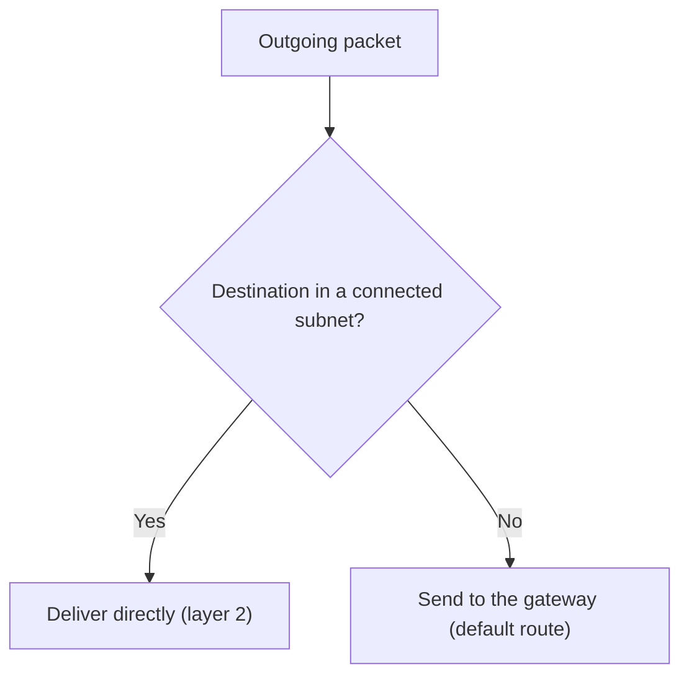
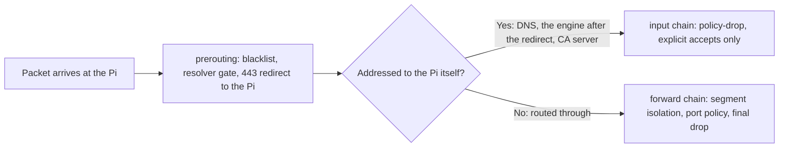
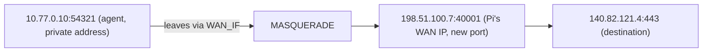

# 01 — IP addressing, routing and NAT

All of the steps in this file occur *below* the fence. Before the gateway examines one TLS byte, the packet must get an address, a route, and NAT. Pi Fortress is a gateway, so it does all three steps.

## 1. Addresses and subnets

Think of an office where each desk phone has an internal extension. Phones in the same building can call each other directly. No receptionist is necessary. A call to a phone in a different building must first go out through a switchboard. A **subnet** works the same way. A subnet is a range of addresses that can reach each other directly over the local network (Ethernet frames, ARP). No router is necessary.

An IPv4 address has 32 bits. You write it as four octets. The `/n` suffix gives the number of leading bits that are the "building", not the "desk":

| Notation | Network part | Hosts | Example use |
|---|---|---|---|
| `10.77.0.0/24` | first 24 bits | 254 | the agent segment |
| `10.79.0.0/30` | first 30 bits | 2 | the desk point-to-point link |
| `0.0.0.0/0` | none | everything | "the default route's match" |

Two special ranges are important here:

- **RFC 1918 private space** — `10.0.0.0/8`, `172.16.0.0/12`, `192.168.0.0/16`. Routers on the public internet do not route these addresses. All segments here use them. NAT (below) lets them reach the internet all the same.
- **RFC 5737 TEST-NET** — `192.0.2.0/24`. The RFC guarantees that no real host ever gets an address in this range. Thus the block-test canary `192.0.2.1` can never be a real destination by accident. The echo hosts in the lab use `192.0.2.2`/`.3` for the same reason. Tests never connect to an untrusted host. The canary *is* the proof that a drop works.

**In Pi Fortress:**

- The agent segment is `10.77.0.0/24`. The Pi is at `10.77.0.1`. The agents are at `.10`/`.11`/`.12`. After the VLAN split, the segment also has a Docker macvlan range `.128/25`.
- The house network is `10.78.0.0/24`.
- The desk link is `10.79.0.0/30`.

## 2. The gateway and the default route

Think of the switchboard operator again. All calls go to the operator first. The operator connects a call for a person in the building directly. The operator sends all other calls to the one outside line. The **routing table** of a computer works the same way. For each packet that goes out:

- If the destination is on a directly connected subnet, the computer delivers the packet on that subnet.
- If not, the packet goes to the **gateway** of the most specific route that matches.

The **default route** (`0.0.0.0/0`) is the least specific match of all. It catches all packets that no other route matches.



This has two results. Pi Fortress uses both:

- **The gateway sees all packets.** The default route of the agent *is* the Pi. Thus the Pi controls all of the traffic of the agent. The Pi is not a sandbox that the agent can argue with. It is a router that the agent must send its traffic through.
- **The default route can move.** A Wi-Fi adapter on the desktop, a second cable, or a USB tether each tries to install a new default route. That route is a path around the Pi. Thus the desktop must never forward traffic between its networks. If it does, it becomes a second gateway that routes around the Pi.
  - The lock step of the desk setup script (`setup.sh lock`) disables forwarding and keeps it disabled. Thus an adapter that you connect again cannot make the desktop a router.
  - The default route of the desktop itself must point only at the Pi. The lock step of the desk setup script refuses a desktop with Wi-Fi on, a second default route, or a second routed cable.
  - On the Pi itself, **the uplink is a role, not a port**. Pi Fortress detects `WAN_IF` as "the interface that has the default route". It never writes a literal `eth0`/`wlan0` into the rules. If you change a cable uplink to Wi-Fi, only a name changes. You do not need a second copy of the rules.

**Check it yourself (lab):**

- On an agent VM, `ip route` shows `default via 10.77.0.1 dev eth1`.
- On the Pi, `ip route` shows the default route through the uplink. It also shows `10.77.0.0/24 dev eth1` as a connected route. On the real Pi, this interface is `eth0.20`.

## 3. Forwarding: the Pi is a router

A usual computer opens only the packets for its own address. This is like a person who reads the letters in their own mailbox. A router *forwards* packets between two networks. This is like a mail sorting office that relays a package for a different address. On Linux, a router needs `net.ipv4.ip_forward=1`. It also uses a different nftables hook: `forward`, not `input`.



- All packets go through `prerouting` before routing. For the agent, `prerouting` holds the IP blacklist, the resolver gate, and the TCP 443 redirect. The redirect changes the destination of an HTTPS connection from the agent. The new destination is the engine on the Pi.
- Traffic **through** the Pi goes to `forward`. This chain holds segment isolation and the port policy of each segment. The chain drops all other traffic that the agent sends out. The one exception is SSH to an address in `ssh_allow.ips`.
- Traffic **to** the Pi itself goes to `input`. This is agent DNS to :53, the engine on :8080 after the redirect, and the www CA server on :80. The `input` chain is policy-drop. For the agent, it has explicit accepts for 53, 80, 8080 and ping, only from the agent NIC.

## 4. NAT and MASQUERADE

Think of an apartment building with one street address and fifty units. Unit 12 sends a letter. The front desk changes the return address to the address of the building, not of the unit. The front desk also records which unit sent the letter. When a reply comes to the building, the front desk sends it to unit 12. **Source NAT (masquerade)** does this for private IP addresses. Without NAT, a packet from a private address stops at the first router on the public internet:

```
before:  10.77.0.10:54321 → 140.82.121.4:443
after:   198.51.100.7:40001 → 140.82.121.4:443   (Pi's WAN IP, new port)
```



The router records the mapping in the **conntrack** table (next section). It changes reply packets back to the original address. MASQUERADE is SNAT that selects the source IP automatically. It is the correct choice for an uplink with an address that can change, for example Wi-Fi or DHCP.

**In Pi Fortress:**

- Desk egress is NAT, behind a filtered resolver, a resolver gate on all ports, and the strict port set of the house.
- House egress is NAT plus the strictness level that you select (`HOUSE_EGRESS`: strict, audit or open). This level decides which ports and connections pass.
- House egress can also go out through a WireGuard VPN tunnel, not the raw uplink. Desk egress always goes out through the uplink.
- Agent HTTPS egress is *not* NAT. The gateway redirects it into the fence (tutorial 05). The broker then opens a new connection from the WAN address of the Pi. Only SSH to an `ssh_allow.ips` address leaves the agent segment through NAT.

## 5. Conntrack — state the firewall remembers

Think of a phone operator who connects a call. After the connection, the operator does not examine each word again for permission. The operator keeps the line open and sends replies back to the correct handset. **Connection tracking** does this for network flows. A flow is the 5-tuple of protocol, source IP, source port, destination IP, and destination port. Each flow gets a state: `NEW`, `ESTABLISHED`, `RELATED`, or `INVALID`.

The ruleset uses this in two places:

- `ct state established,related accept` is the first accept in `forward`. Flows that are already open skip the policy checks for each packet. Thus **the segment-isolation rules come after it**. They control only new flows.
- The ruleset drops `INVALID` early. A packet that is not part of a known flow has no legitimate reason to exist. Examples are an off-by-one sequence number or half of a handshake.

The observe subsystem reads the same table (`/proc/net/nf_conntrack`, with accounting on). It logs the bytes for each destination. This value is the high-water mark of one flow on that tuple. It is not a guaranteed total.

## 6. Ports

A port is a 16-bit number. It lets many conversations use one IP address. This is like the one street address of an apartment building, with a different number for each unit. By convention, 443 is HTTPS, 53 is DNS, 22 is SSH, and 853 is DoT.

The fence allows *only* these paths out of the agent segment:

- TCP 443, into the fence.
- 53, to the Pi.
- 80, to the Pi, for CA enrolment.
- Ping, to the Pi.
- TCP 22, only to an address in `ssh_allow.ips`. This list is empty by default.

The fence drops all other traffic. This includes 8443 (a classic "HTTPS but elsewhere" escape) and 51820 (WireGuard). If the agent can reach an origin server on 443, that does not mean that the origin server is *approved*. The resolver gate and the blocklists decide that (tutorial 03).

## 7. Where you see it

| Concept | Where you see it |
|---|---|
| Subnets, addressing | `ip -br addr`; `sudo pf status` |
| Default-route detection | `ip route` (default line plus connected routes) |
| Prerouting, forward and input | `sudo nft list ruleset` (`filter_prerouting`, `resolver_gate` and `prerouting` before routing; separate `input` and `forward` chains after routing) |
| MASQUERADE | `sudo nft list ruleset \| grep masquerade` |
| Conntrack | `sudo pf observe once`; `sudo conntrack -L` |
| TEST-NET canary | `blacklist.ips` in `/opt/pi-fortress/vm/policy/` (`192.0.2.1`) |
