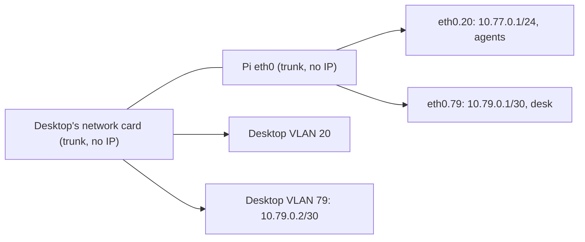
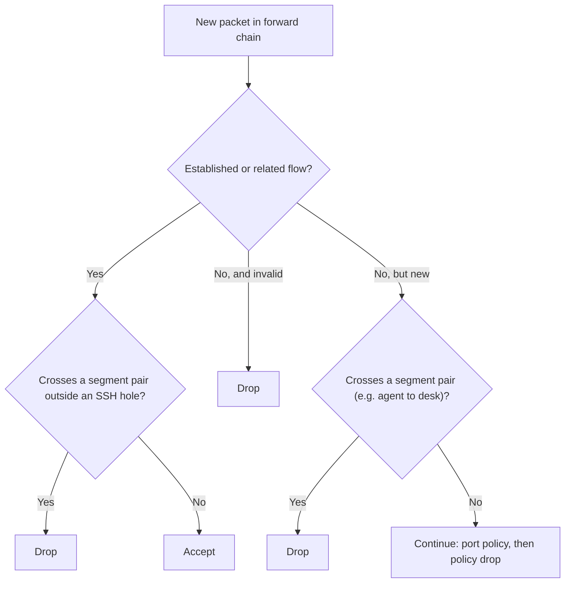

# 02 — VLANs and segment isolation

One cable, two networks. This file shows how the real Pi serves the agents and the desk from one Ethernet port, and the house from a second port. It also shows how the Pi keeps each network separate from the others.

## 1. The problem: one wire, several trust tiers

The Pi 5 has a limited number of ports. One cable connects the desktop to the Pi. The agents run as VMs or containers on that desktop. But the trust model needs three separate planes:

| Plane | Segment | Trust |
|---|---|---|
| Agents | VLAN 20, `10.77.0.0/24` | **Hostile** — inspected, fenced |
| Desk (human seat) | VLAN 79, `10.79.0.0/30` | **Possibly compromised** — filtered DNS and ports, inspected only with `INSPECT=on` |
| House devices | `eth1`, `10.78.0.x` | Light policy (feeds, DNS pin) |

## 2. What a VLAN is

Think of a cable TV line into an apartment building. One physical wire carries all channels. But each set-top box shows only the channels that it is tuned to. The box cannot see the other channels, although the same cable delivers them all.

An 802.1Q **VLAN tag** does the same job for network traffic. It is a 4-byte field in the Ethernet frame header. It holds a 12-bit VLAN id. Switches and routers use each id as a separate network that the other networks cannot see. A frame with tag 20 never comes out of a port that carries only VLAN 79. To go from one VLAN to a different VLAN, the frame must be *routed* (a layer-3 step). The firewall is exactly at this step.

Linux applies these tags in software. The interface `eth0.20` is a **VLAN child** of `eth0`. It sends and receives only frames with tag 20. The physical `eth0` itself carries all tags and has **no IP address of its own**. It is the **trunk**, the shared wire.



**In Pi Fortress:** `/etc/pi-fortress/segments.d/desk.env` has `IF=eth0.79`. The dot makes it an 802.1Q child. Pi Fortress gets the VLAN trunk and the child interfaces from the segment files. It activates them with `nmcli`. Later, you can add a VLAN-capable AP on the house port. For this, you only write `IF=eth1.30` / `IF=eth1.40`, with one SSID for each VLAN. But those segments get only house trust. Refer to "A VLAN per SSID on the house port" in section 5.

## 3. Double-tagging: the attack this closes

If the agent side can *tag its own frames* (for example, with VLAN 79), it can talk on the desk segment. These frames then do not go through the router at all. Two defenses stop this attack:

1. The uplink of the agent VM sees **VLAN 20 untagged**. On the real desk, VirtualBox bridges the VM onto the VLAN 20 child of the desktop. In the lab, it is a VirtualBox internal network with no VLAN awareness at all. If the agent tags a frame with 20, the frame arrives at the Pi with two tags. Switch semantics drop it.
2. If a frame gets through, **segment isolation** (next section) stops it. Segment isolation drops cross-segment flows in the forward chain. The interface where the flow arrived has no effect on this.

## 4. Segment isolation — the first real policy rule

Isolation is a set of nft rules in the **forward** chain. The position of these rules is important:

```
forward:
  ct state established jump isolate_ct    ← established flows: isolation again
  ct state established,related accept     ← then established flows pass
  ct state invalid drop
  # from here on: NEW flows only
  iifname "eth0.20" oifname "eth0.79" drop     ← agent → desk
  iifname "eth0.79" oifname "eth0.20" drop     ← desk → agent
  iifname "eth0.20" oifname "eth1"    drop     ← agent → house
  ... (every pair, both directions)
  # then: each segment's port policy, then policy drop
  # (blacklist, resolver gate and 443 redirect already ran in prerouting)
```



The position after the conntrack accept is important. These rules control only **new flows**. Isolation comes before the agent block.

An apply does not flush conntrack. Thus `isolate_ct` holds the same pair drops and SSH holes for **established flows**. It matches each hole in the two directions of the flow. If an apply removes a hole, the flows that use it stop at their next packet. Flows that cross no pair go on to the conntrack accept. Each pair has one `drop` for each direction, never `reject`. Thus a prober gets only silence.

An egress change of a segment is different: the egress policy does not examine established flows. Thus apply **ends the open flows** of each segment whose egress policy changed, and of each segment that you removed. For the house, the egress policy is `HOUSE_EGRESS`, the `HOUSE_ALLOW_*` switches, `HOUSE_ALLOW_PORTS`, `HOUSE_BLOCK_DIRECT_IP`, `HOUSE_BLOCK_HTTP`, `HOUSE_BLOCK_VPN` and `HOUSE_PRIVATE_DNS`. For a plain segment, it is `EGRESS`, `ALLOW_PORTS`, `BLOCK_DIRECT_IP` and `ssh_allow.ips`. A key that you set to its default value is not a change. After the new ruleset is loaded, apply deletes the conntrack entries whose source or destination is in the subnet of that segment, and logs one line for each segment. The devices open their connections again under the new policy. Flows to and from the addresses of the Pi stay, so an SSH session to the Pi continues. The flows of the other segments stay. A change of a different key ends no flows. Apply keeps the last policy in `/var/lib/pi-fortress/egress.state`. If this file is missing or empty, apply cannot know the last policy, so it ends the open flows of each segment. On a new box this ends nothing: forwarding is off until the first ruleset is loaded. If `conntrack` is not installed, apply gives a warning, and the open flows keep the old permission until they close.

**Holes are named, not implicit.**

- The house gets exactly one hole: the `HOUSE_ADMIN_IP` can reach one agent VM on tcp/22. `HOUSE_SSH_TO` can widen this to a range of agent VMs.
- A plain segment gets a hole out only if its file names `SSH_TO`.
- A plain segment gets a hole in only if its file names `SSH_FROM`. This hole is one address that can open tcp/22 into the segment, with no way back. The address can arrive only from the house or from a different plain segment. It can never arrive on the uplink or the WireGuard tunnel.
- A segment on the house cable gets no `SSH_TO` (section 5).

**Only the agent segment** can reach the engine on 8080 or the CA server on 80. The house cannot touch the fence.

## 5. Plain segments are data, not code

The desk segment did not need special-case code. It is one settings file. In the same way, you can order a standard trim level from a catalog, and the maker does not design the car again:

```
# /etc/pi-fortress/segments.d/desk.env
IF=eth0.79          # dot = 802.1Q child
NET=10.79.0.0/30
IP=10.79.0.1
ADMIN=yes           # accepts ssh to the Pi? yes, for the seat
SSH_TO=             # no hole into the agent net
#EGRESS=strict      # ports: strict, audit or open
#SSH_FROM=10.78.0.20  # one address that may ssh in
```

The agent VMs run on the desk machine. Thus Pi Fortress assumes that an agent can escape to a plain segment. A plain segment gets:

- NAT to the uplink.
- Isolation from all other segments.
- The shared IP blacklist.
- A resolver on the Pi with the block lists of the agent. The resolver answers only with addresses. It refuses key-shaped names.
- DNS, QUIC, DoT, and the addresses of the DoH servers pinned in the same way as on the house.
- A resolver gate on each new connection and ping, on all ports.
- No local addresses at all.
- The strict port set of the house.

Without `INSPECT=on`, it does **not** get TLS inspection, the site-name check, or credential substitution. `pf apply` validates these files. It refuses duplicate interfaces or overlapping ranges. After each refusal, the old ruleset stays loaded.

The house is the one *hand-written* segment, because it has its own settings (filters, reservations, the WireGuard tunnel). A second AP on a USB adapter is only `IF=eth2`. It is still plain data. A plain segment can also serve DHCP. For this, set `DHCP=on` with a `DHCP_START`–`DHCP_END` range in `NET` (below).

### A VLAN per SSID on the house port

Usually, a cable connects the house port to a consumer Wi-Fi router in AP mode. If the AP can put each SSID on its own VLAN tag, that one cable carries several networks. For example, the house is untagged, and an IoT SSID is on VLAN 30, with the Pi as its gateway:

```
# /etc/pi-fortress/segments.d/iot.env   (house.env has HOUSE_IF=eth1)
IF=eth1.30
NET=10.30.0.0/24
IP=10.30.0.1        # gateway and DNS for the IoT devices
DHCP=on             # the Pi leases addresses on this SSID
DHCP_START=10.30.0.100
DHCP_END=10.30.0.199
```

A device that needs the same address each time gets a reservation. An example is a camera that you watch from the desk. The reservations are in a file next to `segments.d`. The file uses the `house.hosts` format of the house: one `mac,ip,name` line for each device. The name is optional:

```
# /etc/pi-fortress/dhcp.iot.hosts
02:00:00:00:00:0a,10.30.0.50,doorcam
```

Most IoT devices cannot use a static address, so the Pi gives them one. A device with no address sends a DHCP DISCOVER from `0.0.0.0` to the broadcast address `255.255.255.255`, UDP port 67. The answer from the Pi gives the device:

- An address from the range.
- The Pi (`IP`) as its router and as its DNS server.
- A 12-hour lease.

The source of that first packet is outside `NET`. The spoof check of the segment would drop it. Thus, with `DHCP=on`, the segment gets the same exception as the house. The Pi accepts `0.0.0.0` on UDP 67 to the Pi or to broadcast, and nothing else. This traffic is input to the Pi. The Pi never forwards it.

The DHCP of each segment is its own small server (`pi-fortress-dhcp@iot`). This server binds only to that VLAN. Apply refuses a range that:

- Is outside `NET`.
- Covers `IP`, the network address, or the broadcast address.
- Runs backwards.

Pi Fortress writes a reservation only into the server of that segment. The reservation can be in the range or outside it, as on the house. Apply refuses:

- A malformed MAC.
- An address outside `NET`.
- `IP` itself.
- The network or broadcast address.
- A MAC or an address that is in the file two times.
- All reservations while `DHCP` is off.

The AP must not run its own DHCP on that SSID. In AP (bridge) mode, it does not.

These tags are only as strong as the AP. A device on one of its SSIDs can send frames with tag 30. A compromised AP can do this too. These frames arrive on the IoT segment, as if the device joined it. Thus Pi Fortress gives each network on the house cable house trust or lower:

- `pf apply` refuses `ADMIN=yes` (SSH to the Pi) and `SSH_TO` (SSH into the agents) on such a segment. It also refuses the agent network (`INT_IF`) anywhere on the house cable.
- The house cable is the port of `HOUSE_IF`. With `HOUSE_IF=eth1`, `eth1.30` is on it. With `HOUSE_IF=eth1.10`, `eth1.30` and untagged `eth1` are also on it.
- `SSH_FROM` stays allowed. It names who can SSH *into* the segment. It gives nothing to the segment itself.
- Each apply gives a warning: the segment is only as isolated as the AP or switch. Use an AP or switch that maps each SSID to its own VLAN tag. It must not pass tagged frames from its clients.

All other settings are the plain-segment posture above:

- Isolation from the house, the agents, and all other segments, in the two directions.
- Only DNS, ping, and (with `DHCP=on`) DHCP to the Pi itself.

DHCP gives nothing more than house trust, so Pi Fortress allows it on the house cable. The segment does not get one thing that the house has: the WireGuard tunnel of the house. The Pi routes only `HOUSE_NET` into that tunnel. IoT devices often connect to addresses that they did not look up. Run `EGRESS=audit` for a day. Use `BLOCK_DIRECT_IP=off` only if the gate is the cause of the failure.

## 6. The desk is a seat, not a router

If the desktop is not locked, it can break the full topology. With `ip_forward=1` and a Wi-Fi adapter, it becomes a second gateway that routes around the Pi. In the same way, a guest Wi-Fi router in an office can send the internal network to all persons nearby, if someone changes its configuration.

The desktop must never forward traffic between its networks. If it does, it is not a seat. It becomes a second router. The lock step of the desk setup script (`setup.sh lock`) disables forwarding and keeps it disabled. Thus, if you connect a Wi-Fi adapter to the desktop again later, the VMs still cannot use it to go around the Pi.

The traffic of the desktop itself needs one more rule: the Pi must be its only uplink. A second way out skips all rules on the Pi. Examples are Wi-Fi that is on, a different default route, or a second cabled port. An agent that escapes its VM would use that way out. The lock step of the desk setup script refuses a desktop that still has a second way out. It also names that way out.

## 7. Lab vs hardware

In VirtualBox, "VLAN 20 untagged" is an **internal network** (`virtualbox__intnet`). This is a virtual switch that connects only the VMs on it. The host has no path to it. The isolation property is the same, but the mechanism is different: it uses no tags at all. The hardware cutover ([Pi setup](../pi_setup.md#5-cable-the-agent), step 5) changes the agent interface from VirtualBox `eth1` to `eth0.20`. Nothing else changes. The ruleset and the addresses stay the same. Only one interface name changes.

## 8. Where you see it

| Concept | Where you see it |
|---|---|
| Trunk + children | `ip -br link` (shows `eth0`, `eth0.20`, `eth0.79`); files under `/etc/pi-fortress/segments.d/` |
| Isolation rules | `sudo nft list ruleset` (the `forward` chain) |
| Named holes | `HOUSE_ADMIN_IP` in `/etc/pi-fortress/house.env`; `SSH_TO` and `SSH_FROM` in a segment's file under `/etc/pi-fortress/segments.d/` |
