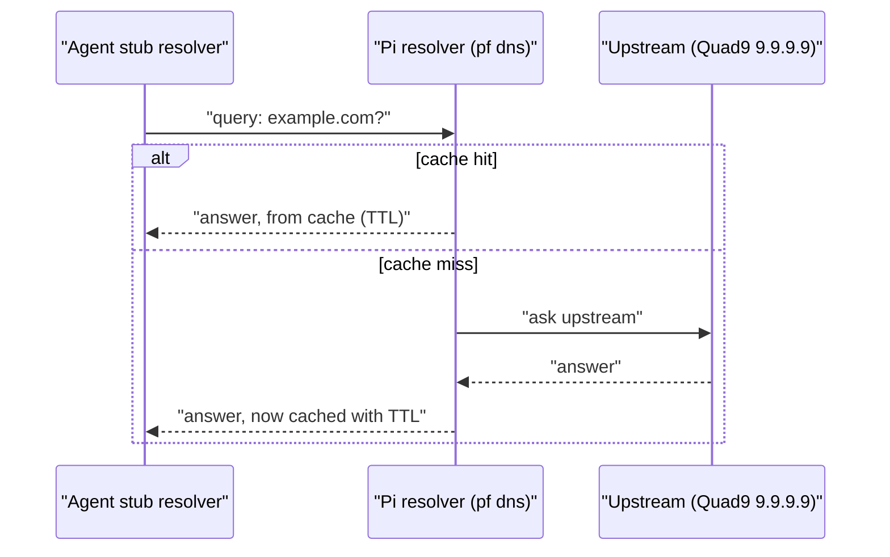
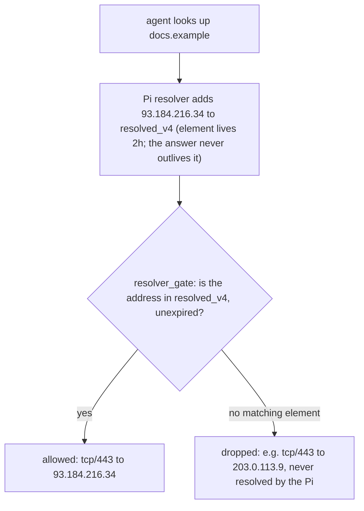

# 03 — DNS, sinkholing, DoH/DoT and the resolver gate

DNS is the phone book of the internet. It changes a name like `example.com` into an address like `93.184.216.34`. It is also the cheapest place to control what a machine can reach. Thus Pi Fortress uses DNS a lot. For the same reason, an agent that wants to get out also tries to abuse DNS.

## 1. How a lookup works

**Everyday example:** you call the switchboard of a company and ask for "accounts." The operator finds the extension and connects you. The operator also remembers the extension for some time. Thus the next caller does not need to ask again.

DNS works the same way:

- The **stub resolver** is the simple lookup client on the machine of the agent. It asks one server for an answer and waits.
- The **recursive resolver** does the real work. Here, that is `pf dns`, which runs on the Pi.
  - It examines its cache first. On a hit, it answers immediately.
  - On a miss, it asks an upstream resolver (Quad9, `9.9.9.9`). That resolver then asks the authoritative servers that own the answer.
- Each cached answer has a **TTL** (time to live). The TTL is the time that a resolver can use the answer again. After that time, the resolver must look up the name again.
- Three record types are important here:
  - `A` (an IPv4 address).
  - `AAAA` (an IPv6 address).
  - `HTTPS` (a newer record type that can advertise a DoH endpoint). Pi Fortress also filters this type. Refer to §3.



**How Pi Fortress uses it:** the DNS of the agent is **pinned** to the Pi. The agent must use only that resolver, whatever the agent tries. Pi Fortress pins it in three separate ways, because one way is not sufficient:

1. The `setup.sh` of the agent sets `10.77.0.1` (the Pi) as its only resolver. It also locks `/etc/resolv.conf` against changes.
2. The firewall rules on the agent drop all queries to port 53, except queries to the Pi. Thus a VM cannot use the NAT of its host to get to a different resolver.
3. The firewall on the Pi drops incoming port-53 traffic, unless the traffic is addressed to the Pi itself. It also drops all port 853 traffic (DoT/DoQ, encrypted DNS, refer to §3).

Also, the resolver of the agent never returns an IPv6 (`AAAA`) answer. This setting is filter-AAAA. Thus a program that tries IPv6 to go around the filter has no address to connect to. IPv6 is also disabled on the two machines (tutorial 05).

## 2. Sinkholing: the name blocklist

**Everyday example:** a blocked phone number that does not ring. It always connects to a dead line. The caller dials, hears nothing, and stops. The caller never gets through and does not learn the cause.

A **sinkhole** does the same for a domain name. The resolver answers a blocked name with `0.0.0.0`, an address that goes nowhere. It does not ask upstream at all. From the agent:

```
$ dig +short pi-fortress-block.test
0.0.0.0
```

The block also applies to all subdomains: if you block `name`, you also block all names under it. The match goes through the labels. It does not know which parents are shared hosting zones, because there is no Public Suffix List check. Thus, a feed can list `herokuapp.com` to catch one bad `x.herokuapp.com`. Then the sinkhole blocks all apps on `herokuapp.com`. Pi Fortress accepts this over-block, because it must not miss a subtree. It uses careful curation of the lists to keep a shared parent out.

If a shared parent gets onto a list, the escape hatch is `never_block.domains`. This fix is as coarse as the problem. It must name the parent itself, `herokuapp.com`. This opens all tenants under the parent again, also the bad one. Public Suffix List handling would keep a shared parent off the list from the start. It is not planned.

Pi Fortress compiles the blocklists. You do not edit them by hand. Pi Fortress merges the feed data with a local list of canary domains. Then it removes each entry that overlaps `never_block.domains`. It removes the full entry. If you exempt one address (a `/32`), Pi Fortress removes the full entry that contains it. For example, if that entry is a `/16`, Pi Fortress removes the full `/16`.

`never_block` has priority over the blocklists. But it does not have priority over the DNS pin above. You can exempt a domain from the blocklist, but the agent still cannot query a server other than the Pi. Also, `1.1.1.1` and `8.8.8.8` (public DNS resolvers) are not in `never_block`, on purpose. The DoH endpoint list, `doh.ips`, controls them.

There are two enforcement points on purpose:

- The sinkhole catches a client that asks the resolver for a name.
- A separate check, at the engine and broker (tutorial 04), catches a client that does not use DNS. Such a client connects directly to a hard-coded IP address.
  - If that connection has an HTTPS SNI, the fence still applies to it. The SNI (Server Name Indication) is the host name that the client sends before encryption starts (tutorial 04).
  - If the connection has nothing that the gateway can recognize, the gateway blocks it outright.

**Testing note:** never connect to a real bad host to confirm a block.

- Block tests use only `dig` (a DNS lookup tool). They never use `curl` or a live connection.
- The canary domain `pi-fortress-block.test` (a domain reserved for tests, RFC 2606) must resolve to `0.0.0.0`.
- You can look up a real host name from a threat feed, such as URLhaus, with `dig` against the Pi. This confirms that it goes to the sinkhole. Never fetch it.

## 3. Why encrypted DNS is the adversary's favourite tool

**Everyday example:** a guard at a gate can stop you if you say your destination aloud. Thus you whisper it in a code. The guard still sees you go through, but cannot know where you go. Encrypted DNS is that whisper.

The gateway can see plain DNS (UDP port 53). Thus an agent that wants to get out tries to encrypt its DNS queries:

| Escape | What it is | How it is closed |
|---|---|---|
| **DoT** | DNS over TLS, on tcp/853 | The gateway drops port 853 when it arrives, in prerouting (tutorial 05) |
| **DoQ** | DNS over QUIC, on udp/853 | The gateway drops port 853. It also drops all QUIC. |
| **DoH** | DNS in a usual HTTPS connection, on tcp/443. From the address only, it looks the same as normal web traffic. | Refer to the list below |

DoH is the difficult case. A query like `https://dns.google/dns-query?dns=...` uses the same port and encryption as all other web requests. But three layers catch it:

1. The gateway always drops or sinkholes the addresses and names of known DoH providers. `never_block` cannot open them again.
2. The broker catches a DoH request to a different server by its **request signature**. The broker returns `403` for each `/dns-query` path or `application/dns-message` content type, in all locations.
3. A DoH lookup that gets through is useless, because of the resolver gate (§4). The firewall does not pass port-443 traffic to an address that the Pi itself did not resolve.

## 4. The resolver gate — "only where the Pi looked"

**Everyday example:** a building where the elevator goes only to the floors that the front desk registered you for. You can know a room number. But the elevator button does nothing until the front desk puts your name on the list for that floor.

The resolver gate is that structural defence. The agent cannot reach a destination that the Pi did not look up. This stops a direct connection to an IP address. It also stops all that DoH can otherwise make possible. The two fail closed automatically.

**Mechanism, with `AGENT_DNS=forward`:**

- Each time `pf dns` resolves an `A` record, it writes that address into an nftables **set** called `resolved_v4`. A set is a fast lookup table in the kernel (tutorial 05).
- Each element lives two hours. If an answer would live longer than the element, the resolver restarts the timer of the element. Thus the answer that the agent gets, from the cache or new, never has a TTL longer than the remaining time of the element.
- The `resolver_gate` chain is on the prerouting hook. It lets the agent reach tcp/443 only on an address that is in `resolved_v4` and is not expired. A manual exemption list, `direct_ip.allow`, also counts.

**Fake-IP, the default.** With `AGENT_DNS=fakeip`, the agent never sees a real address at all.

- `pf dns` answers each name with a stand-in from `FAKEIP_NET` (`198.18.0.0/16` by default). Each name gets one address. `pf dns` does not ask an upstream server.
- The gate then passes tcp/443 only to that stand-in range.
- The redirect sends the connection to the engine.
- After the TLS handshake gives the host name, the broker resolves the real name itself, from the Pi. Then it connects to that address.

A lookup alone sends nothing out of the network. An address that the agent got in a different way still meets the gate. The flow below shows forward mode.



The firewall rules on the agent add a second layer on the client side. Port 53 reaches only the Pi. Those rules also drop port 853. Thus the resolver on the Pi is the only DNS source that can give an address that the gate passes.

## 5. The Go resolver (`pf dns`) — why it exists

**Everyday example:** one thermostat controls all rooms in a shared house, but each room wants a different temperature. To give each room independent control, you need one thermostat for each room. Or you need one better system that controls each room separately.

The policy settings of dnsmasq (`nftset=`, `server=`, its sinkhole config file) apply to the full process, not to each client. Thus two network segments with opposite rules need two separate dnsmasq processes. This does not scale well: N segments need N+2 processes.

**How Pi Fortress uses it:** `pf dns` replaced dnsmasq in the DNS role. dnsmasq does only DHCP now. `pf dns` is one daemon that applies a policy for each segment natively. It writes logs in a format that the observation tools already read. It parses DNS messages with `golang.org/x/net/dns/dnsmessage`. This is a small library close to the standard library, not the larger third-party `miekg/dns`.

## 6. DoH sinkholing on the house

The house network is the segment of the family, not of the agent. The Pi pins the DNS of the house network in the same way. It rejects port 53 to all other servers. On the house, the Pi also drops known DoH addresses and sinkholes DoH domain names.

There is one exception, on purpose. If you set `HOUSE_PRIVATE_DNS` on, the house can resolve the endpoint name that you select. It can also reach the addresses of that endpoint. The other names in the domain of that provider stay in the sinkhole.

The house sinkhole does not share the `never_block.domains` list of the agent. It has its own list, `house_never_block.domains`.

## 7. Where you see it

| Concept | Where you see it |
|---|---|
| Resolver pin + drop rules | `sudo nft list ruleset` (`filter_prerouting` and `input` chains) |
| Sinkhole lists | `never_block.domains` in `/opt/pi-fortress/vm/policy/` |
| Resolver gate | `sudo nft list set inet fortress resolved_v4`; `direct_ip.allow` in the same policy folder |
| Go resolver (`pf dns`) | `sudo pf status` |
| Observation | `sudo pf observe once`; `/var/log/pi-fortress/dns.jsonl` |
