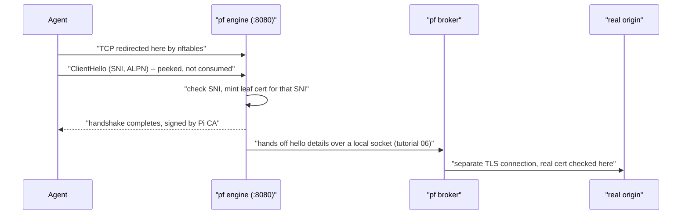

# 04 — TLS, transparent interception and the per-site certificate

This file shows how the fence reads encrypted traffic, although the agent did not configure a proxy. It also shows what the fence refuses to read.

## 1. What TLS gives you (and what it does not hide)

**Everyday example:** you put a letter in an envelope and seal it. Thus no one can read it in transit. But before you seal it, you must write the name of the destination on the outside. You must also select a language on the outside. The postal service needs this information to route the letter and to find a translator. All persons who touch the envelope can see that outside text, but the letter inside stays sealed.

TLS, on tcp/443, encrypts the HTTP conversation. But it does this only *after* a handshake. The handshake starts with a **ClientHello**. The client sends it in plain text, because the client has no encryption keys yet. It contains:

- **SNI** (Server Name Indication): the host name that the client wants to reach. This is the modern way to say where a connection goes, and it is not encrypted.
- **ALPN**: the protocols that the client can use (`h2` for HTTP/2, `http/1.1`).
- Cipher suites, extensions, and elliptic-curve points. Their order is specific enough to identify the client software. A fingerprint of this order is a **JA3** fingerprint. Other variants are the normalized **JA3N** and the newer **JA4**.

Thus, before decryption, all parties on the network path already know *which host* the client wants. They also know *which client software* asks. This is sufficient information for a policy decision.

## 2. Transparent interception, no proxy variable

**Everyday example:** a company mailroom makes a photocopy of each letter before the letter leaves the building. It does this for all mail chutes. The employee does not need to write "via mailroom" on the letter. The interception occurs because of the structure of the building. It does not need the cooperation of the employee.

A configured proxy (set with an `HTTPS_PROXY` variable) needs the cooperation of the application. An agent can unset the variable. Pi Fortress **redirects packets** at the network level:

- The firewall sends outbound tcp/443 traffic from the agent to port 8080 of the engine (tutorial 05).
- The engine finds the real, original destination of the connection with a Linux kernel feature, `SO_ORIGINAL_DST`.

The agent thinks that it talks directly to the destination. The engine is on the path because the router put it there. Pi Fortress never asks for cooperation, so the agent cannot refuse it.

Then the engine **peeks** at the ClientHello. It does not fully take control of the connection.

- It reads the hello, up to 16 KiB. This is an exact limit. Each read can use only the remaining part of that budget. Thus the other side cannot go above the limit with a different split of its data.
- Then the engine replays the same bytes to the real TLS server behind it.

For the agent, the handshake continues as usual.

## 3. The engine's decisions at hello time

**Everyday example:** the mailroom compares the destination name on the outside of the envelope with an allowed list. If the name is on the list, the mailroom seals the letter again with its own wax seal. The building of the employee already trusts this seal. Then the mailroom sends the letter.

The engine parses the ClientHello:

- It discards GREASE values. These are dummy values that some clients add on purpose.
- It refuses outright an SNI that is longer than 253 bytes. It also refuses an SNI with characters that are not valid in a host name.
- An SNI in the format of an IP address gets through that character check. But the resolver gate stops it (tutorial 03).

Then `pf engine` makes its decisions:

- It **refuses** an empty or blocklisted SNI. The engine examines the name lists a second time here, after the DNS-level check (tutorial 03).
- It **mints a leaf certificate for exactly that SNI**.
    - The root certificate authority (CA) is ECDSA P-256. The gateway makes it one time, at the first `pf apply`. Its private key never leaves the gateway.
    - The engine caches the per-site ("leaf") certificates. It issues them again before they expire.
    - The agent trusts this Pi CA. The agent gets the CA from the certificate server on port 80 during setup. Thus the TLS stack of the agent sees a normal, valid certificate chain.
    - The broker still examines the real certificate of the origin server. But it does this only on the separate connection that the broker makes to the origin server (§4).
- It offers **only `http/1.1`** through ALPN.
    - A client that can use `h2` and `http/1.1` agrees on `http/1.1`.
    - A client that accepts only `h2` fails the handshake. The error is `no_application_protocol`. The log line is `alpn_h2_only refused`.
    - HTTP/3 uses QUIC. It never gets to this step, because the gateway drops all udp/443 traffic (tutorial 05).
    - Pi Fortress does not try to serve pinned-certificate clients or h2-only clients. A client that pins the real certificate of the origin server cannot go through the fence. A client that accepts only HTTP/2 also cannot go through.

## 4. The two-leg trust split

- **Leg 1 (agent to engine)** is the leg where Pi Fortress moved the trust of the agent. The agent validates the certificate against the CA of the Pi, not against the public web certificate system.
- **Leg 2 (broker to origin server)** is a usual TLS client. It validates the real origin server in the usual way, with the standard public certificate system.

The agent never has the private key of the CA. The **agent segment** trusts the certificate. A desk trusts it only with `INSPECT=on`. The house segment never installs it.

## 5. Why not decrypt the house?

The house segment stays plain. It gets no CA and no TLS inspection (refer to [Home network](../home_network.md#what-it-does-and-does-not-do)). The house segment gets:

- NAT.
- Network isolation.
- The shared IP blacklist.
- The resolver of the Pi, with a DNS pin.
- The malware, phishing, and ad/tracker feeds.
- The DoH, DoT, and QUIC drops.

This is a stated non-goal: Pi Fortress does not inspect TLS on the house segment. The fence is a control for an AI agent. A fence for the phones of the family would be a different product, with a different consent story. Also, an allowlist that is strict enough to be useful would also break normal household browsing. If a control breaks the house, people disable it.

The desk is different. Pi Fortress assumes that an agent can escape to the desk, and the desk holds keys for its own tools. Thus the credential fence is an option for each desk: `INSPECT=on` in its segment file ([FAQ](../faq.md#desk-tls-inspection)). It is off by default. Then the desk gets the filters of a plain segment, without the CA.

## 6. Where you see it

| Concept | Where you see it |
|---|---|
| CA distribution (port 80, agent network only) | `sudo nft list ruleset` (the port 80 allow rule) |
