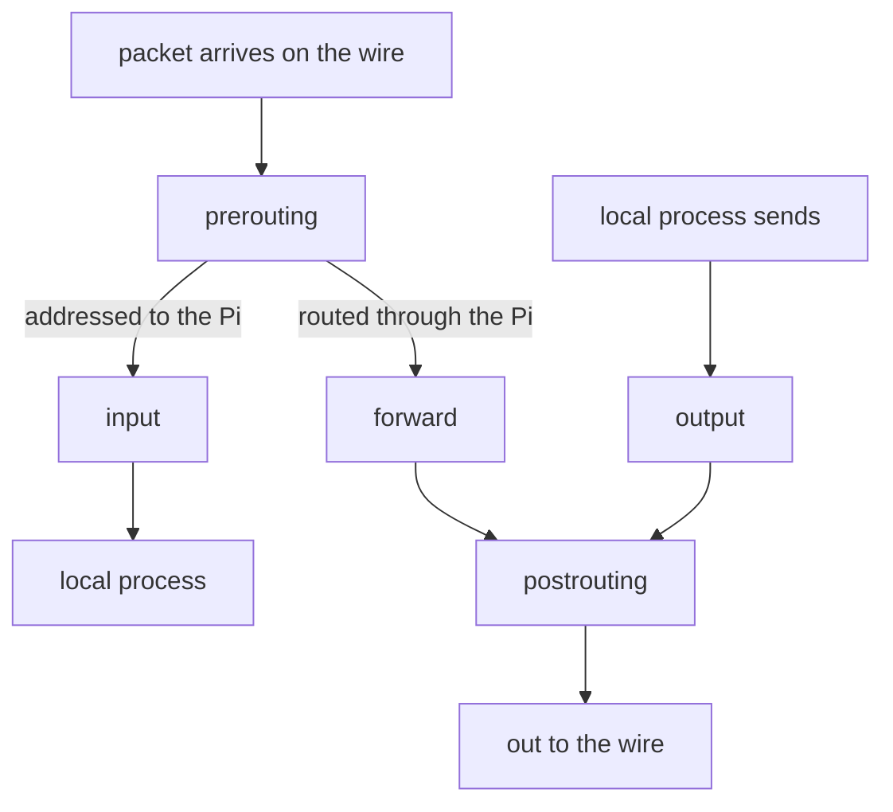
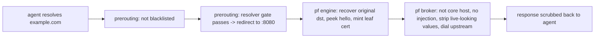

# 05 — nftables: hooks, sets, redirect and fail-closed design

The packet filter is the layer that the agent cannot route around. In this tutorial, "the agent cannot leave" becomes concrete.

## 1. Hooks — where in a packet's life you may speak

**Everyday example:** a postal sorting center. All mail goes through a first checkpoint when it arrives. After that checkpoint, the staff decide:

- Is the mail for a person in the building? Then they give it to that person.
- Does the mail only go through, to a different building? Then they put it back on a truck.

Mail from a person in the building goes through a separate checkpoint before it gets to the loading dock.

nftables attaches **chains** (ordered lists of rules) to **hooks**. Hooks are fixed points in the packet path of the Linux kernel:



- **prerouting** — the first checkpoint after the wire, before the routing decision. Most of the policy for the agent is here, in three chains with different priorities:
    1. The blacklist and the port drops, at `raw` priority (first of all).
    2. The resolver gate, at `-150`.
    3. The tcp/443 redirect, at `dstnat` (§3).

    Thus the gateway drops a canary address like `192.0.2.1` *before* the redirect. The connection times out. It does not get to the engine.

- **forward** — packets that the Pi routes *through* itself. This hook holds segment isolation, the port policy of each segment, and a final policy-drop. The HTTPS traffic of the agent never gets here, because the redirect already made it traffic *to* the Pi. This hook drops all other traffic that the agent sends out. The only exception is SSH to an `ssh_allow.ips` destination.
- **input** — packets addressed *to* the Pi itself. The policy is policy-drop, with explicit exceptions:
    - The network interface of the agent can use ports 53, 80, 8080, and ping.
    - The uplink interface gets rate-limited SSH and ping, and DHCP replies. With `UNTRUSTED_UPLINK=1`, it gets only DHCP replies.
- **output** — traffic from the programs on the Pi itself.
    - The engine cannot start a connection of its own.
    - The broker can connect out only on tcp/443, and only outside the `reserved_v4` range. In fake-IP mode, it can also send DNS queries to its resolver.

    The same packet filter that controls the agent also controls the programs of the gateway.

- **priority** — chains with a lower priority number run first. To make a table run before all others, give it a lower priority number. For example, use `-20` against a default of `0`.

## 2. Sets — matching many values cheaply

**Everyday example:** a doorperson does not compare a name with each entry on a guest list, one at a time. The venue uses a lookup app. You type a name and get a yes or no immediately. The length of the list has no effect on the speed.

A **named set** is that lookup app, in the kernel. A set is a table:

- The ruleset matches against it immediately.
- User programs can update it.
- It can hold full address ranges (CIDR blocks) with `flags interval`.

Pi Fortress has several sets:

- `blacklist_v4` — compiled threat-feed IP addresses.
    - The raw-priority prerouting chain drops matched traffic, before all other rules see it.
    - In fake-IP mode, the gateway also drops matches on the connections that the broker opens out of the Pi. In this mode, the agent connects to stand-in addresses.
    - It is a silent **drop**, not a **reject**. A reject sends back an error immediately. A drop makes the sender wait for a timeout, and the sender learns nothing.
- `resolved_v4` — the live record of the resolver gate. It holds each address that the Pi itself resolved. Each element has an expiry timer (tutorial 03).
- `direct_ip_v4` — exemptions to that gate that the operator defines in `direct_ip.allow`.
- DNS rate meters for each source (`<seg>_dnsflood_{udp,tcp}`, with a limit above 200 requests/second). Thus one client cannot flood the resolver.
- NTP rate meters for each source (`house_ntpflood` and `<seg>_ntpflood`, with a limit above 20 packets/second). Thus one client cannot send more NTP to the gateway than a clock needs.

Feed updates build the *contents* of these lists again. They never change the *rules*. The rules refer to a set by name. `pf apply` replaces the contents of the set.

## 3. Redirect and the original destination

**Everyday example:** you give a change of address to the post office. The post office sends mail for your old address to your new address. It also records the address that was on the envelope, in case a later step needs it.

The full interception scheme uses one rule:

```
nft ... iifname $INT_IF tcp dport 443 redirect to :8080
```

`redirect` is a **destination NAT to the local machine**. For example, a packet for `93.184.216.34:443` gets a new destination: `127.0.0.1:8080`. In practice, the new destination is the address of the interface where the packet arrived. `pf engine` listens there.

The kernel keeps a record of active connections, called **conntrack** (connection tracking). Conntrack remembers the original address, from before the redirect. A program can get that original address with the `getsockopt(SO_ORIGINAL_DST)` call. The engine does exactly this. This call works only on Linux. The engine refuses IPv6. Other operating systems only return an error.

Without this call, the engine knows the network interface where a connection arrived. But it does not know *which host* the agent wanted to reach. Also, the agent can spoof the SNI alone (tutorial 04) before the engine parses the handshake.

With this call, the broker has three independent facts that must agree:

- The **original destination IP**.
- The **SNI**.
- The **Host** header from the HTTP request.

The fence adds a credential only if the SNI and the Host agree on the same **core host** (an approved origin server, tutorial 06 §2). For example, a request with `Host: api.anthropic.com` but SNI `evil.example` gets no credential.

## 4. Fail closed — the design rule this project never breaks

A path that would *skip* inspection is not "allowed". The gateway **drops** it:

| Skips the fence | Status |
|---|---|
| UDP 443 (QUIC / HTTP-3) | dropped — an encrypted tunnel that an inspector cannot open |
| tcp 8443, 80 to the world | dropped |
| tcp 22 (SSH) | dropped, unless `ssh_allow.ips` names a destination (empty by default) |
| 51820 (WireGuard) | dropped — a tunnel around the fence is not an exception |
| IPv6 | disabled on the agent and on the Pi; `meta nfproto ipv6 drop` on the interface of the agent |
| tcp 53 / 853 to all servers other than the Pi | dropped |

Thus a client that pins the certificate of the origin server, or that accepts only HTTP/2, fails *loudly*. It gets a TLS alert or a timeout. It does not go past the fence silently.

The default answer to a really unknown origin server is **allow, but log**, not allow silently. This agrees with "fail closed": the connection still goes through the fence. Nothing goes past the fence silently. Pi Fortress logs the unknown origin server for review. Thus the control stays on, because it seldom gets in the way.

**Fail closed has a real cost**, and this file names it clearly: if the gateway is stuck, the full house goes offline.

## 5. The ruleset is generated, checked, and pinned

**Everyday example:** a print shop makes an official document from a template and your details. Before it prints the full batch, it compares one test copy with a stored master copy. Thus an error in the template cannot silently change each document that it makes.

`pf apply` builds `net.env`, `house.env` and `segments.d/*.env` into the final `nftables.conf`:

- It detects the network interfaces.
- It refuses to continue if there is a collision or an overlap.
- **After each refusal, the ruleset that was loaded before stays in place.** This is the important part.

Before any of this ships, a check compares the generated ruleset with a stored reference configuration. Thus an edit to the template that looks safe cannot silently change the rules on your Pi.

`pf apply` changes the live packet rules. It uses a lock file (`/run/pi-fortress/apply.lock`). If a second `pf apply` starts while the first holds the lock, the second stops at once. It exits with code 75.

## 6. A worked packet walk (agent → https://example.com)

1. The agent resolves `example.com`.
    - By default (fake-IP), the resolver on the Pi answers with a stand-in, such as `198.18.0.7`. It asks no other server.
    - With `AGENT_DNS=forward`, it answers with the real `93.184.216.34`. It adds that address to `resolved_v4` for two hours.
2. The agent opens tcp/443 to that address. The packet goes into the **prerouting** hook of the Pi. The raw-priority chain finds that the address is not in `blacklist_v4`. Thus the chain does not drop it.
3. In **prerouting**, the resolver gate finds that the Pi gave this address (a stand-in, or an address in `resolved_v4`). The nat chain **redirects it to :8080**. The packet is now addressed to the Pi, so it goes to **input**, not to forward.
4. `pf engine` accepts the connection on :8080. Then the engine:
    - Gets the address that the agent connected to, through `SO_ORIGINAL_DST`.
    - Peeks at the ClientHello (`example.com`, ALPN `http/1.1`).
    - Mints a leaf certificate.
    - Sends the connection and the details of the hello to the broker over a local socket (tutorials 04 and 06).
5. The broker applies the policy.
    - `example.com` is not a core host, so the broker adds no credential.
    - The broker strips all values that only look like a live credential.
    - In fake-IP mode, the broker now resolves `example.com` itself. The address that it gets must pass the blocklist on the way out.
    - The broker then connects to the origin server from the Pi itself. The output rules of the Pi allow this. The connection leaves from the address of the Pi on `WAN_IF`, so it needs no NAT (tutorial 01).
6. The broker scrubs the response. The response goes back to the agent through the same pipe.



Now change one detail at a time:

- If the agent did not ask the Pi in step 1, the resolver gate in step 3 finds no matching element. It drops the packet.
- If the destination port is 8443, not 443, the policy drops the packet.
- If the address is IPv6, not IPv4, there is no route at all.

This combination is what "a network your agent cannot leave" means in practice.

## 7. Where you see it

| Concept | Where you see it |
|---|---|
| Hooks & chains | `sudo nft list ruleset` |
| Sets & meters (`blacklist_v4`, `resolved_v4`, per-source DNS and NTP rate meters) | `sudo nft list ruleset` |
| Redirect + original destination | `sudo nft list ruleset` (the tcp/443 redirect rule) |
| Daemon confinement | `sudo nft list ruleset` (output-chain rules for the engine and broker) |
| Apply serialization | `/run/pi-fortress/apply.lock`, held while `pf apply` runs |
