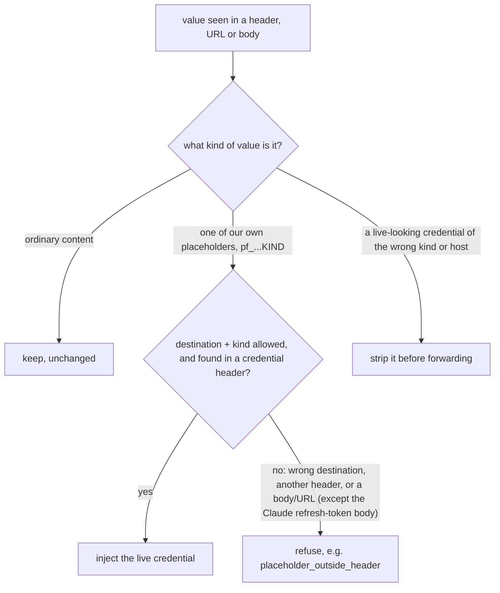
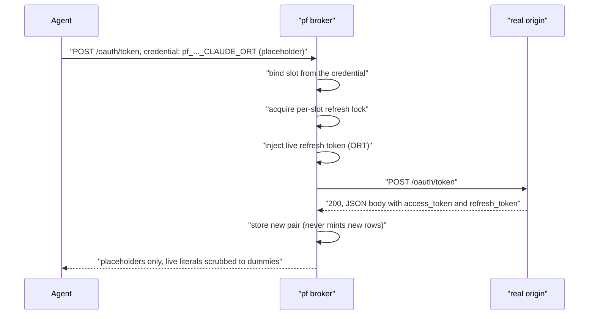

# 06 — HTTP on the wire, the credential fence, and OAuth harvest

This is the innermost layer. After the engine terminates TLS (tutorial 04), the fence reads and changes the HTTP itself. At this layer, the credentials stop existing in the world of the agent.

## 1. Why the broker does not use `net/http`

**Everyday example:** two warehouse clerks handle the same shipment.

- One clerk counts the boxes with a "declared count" label on the outside.
- The other clerk unloads until a special "end of shipment" marker.

A shipment can have the two labels, and the labels can disagree. Then the clerks disagree about where the shipment ends. A person can hide an extra, unauthorized box in that gap, and the two clerks do not see it. **Request smuggling** is this attack on two systems. The attacker makes them disagree about where one message ends and the next message starts. Thus a hidden message can get through and nobody sees it.

The fence must guarantee that **the origin server sees exactly what the fence saw**. There must be no possible disagreement about message boundaries. The fence has its own HTTP/1.1 reader and writer, written from the start. They are made to be safe against adversarial input:

- The fence rejects a repeated `Host`, `Authorization`, or `Cookie` header. The fence changes the first occurrence of these headers. Thus a second occurrence is exactly the smuggling seam above.
- **The fence checks framing strictly.** It refuses:
    - A message with `Content-Length` and `Transfer-Encoding` together. This is smuggling.
    - A `Transfer-Encoding` other than a single `chunked`.
    - A repeated `Content-Length` in a request, also when the values agree.
    - Repeated `Content-Length` values that disagree in a response.

    The fence also limits the header line count and length before it allocates memory for them.

- The fence skips each **1xx interim response**, up to a fixed maximum count. A 1xx response is a "please hold" reply that comes before the final reply.
    - The fence treats a `101` response as an error, unless the request was a WebSocket upgrade. The broker handles a WebSocket upgrade itself and scrubs each message.
    - Thus the fence does not read a `103 Early Hints` reply as the final response. That error would desynchronize the connection for the next messages.
- If bytes stay on the connection to the origin server after a correctly framed response ends, the fence gives a `502` error. Then it closes the connection to the origin server and the connection to the agent.
- **Request-line validation** requires:
    - A token-shaped method.
    - One of the four request-target forms that RFC 9112 defines. The broker then refuses all forms other than origin-form and `OPTIONS *`.
    - An exact HTTP version.
    - Token-shaped header names.

    The fence refuses control bytes in all parts of the request head.

These checks can look like paranoia. But each check is exactly what a request-smuggling vulnerability looks like from the position of the proxy.

## 2. The fence's three choices per request

**Everyday example:** a mailroom clerk reads each letter that goes through.

- The clerk does not change usual content (**keep**).
- The clerk replaces a placeholder token with the real access badge, but only at the door that needs the badge (**inject**).
- If the clerk sees a real badge number in a location where it must not be, the clerk blacks it out. The clerk does this before the letter goes further (**strip**).

The fence makes exactly this decision, separately for each header and for the body: **keep**, **inject the live credential**, or **strip**. The fence scans a body that arrives all at one time as a whole. It scrubs a body that comes as a stream while the stream goes through.

The fence injects a credential only in a **credential header**. The credential headers are:

- `Authorization`.
- `X-Api-Key`.
- Each header that you declare for that host and kind ([Pi setup](../pi_setup.md#headers-a-credential-may-go-in)).

This includes a placeholder in a decoded Basic-auth credential.

If a placeholder is in a different header, the fence refuses the request. This includes `Host` and `Connection`. Reason: providers log headers like `User-Agent` and `Referer`, and can show them back.

The only exception is the Claude refresh token. The broker writes it into the request *body* on `/oauth/token` or `/v1/oauth/token`, only as its `refresh_token` value (§4).

In all other locations, a body or a URL can leak past a scrub. Examples are a model that prints its own prompt in reverse, a public gist, or an access log. Thus the fence refuses outright a placeholder in those locations. The log entry is `placeholder_outside_header`. Strip is different from injection: the fence still strips in the URL, the headers, and the body.

The agent has only **placeholders**, with the format `pf_<16hex>_<KIND>`. The random slot id *is* the dummy value, for example `pf_9f14c2..._CLAUDE_OAT`.

- The live values are only on the Pi, in `/etc/pi-fortress/broker/secrets.env`. The permissions are `0600`, and the broker owns the file.
- Optionally, you can seal the file at rest (`pf enroll seal` / `pf unlock`).
- The broker never replaces a name that is not a known placeholder slot.

**Matching is by kind and by TLS name, not "any core host."** A **core host** is one of the approved origin servers in `core.hosts`. Each core host has a tag with the credential kinds that it can receive.

- A Claude placeholder becomes live only on the way to a Claude host name.
- A GitHub key becomes live only on the way to GitHub.

A host that is not on the list, or a wrong kind for that host, gives exactly one kind of refusal. This is a standard `503` with `Retry-After: 60` and a body that names no cause. Thus a guess gets no feedback.

Also, the fence strips all values that only *look like* a live credential of the wrong kind for a given host. It does this on whole bodies and on streamed bodies, with a set of prefix rules. A match can go past the edge of the 4096-byte scan window. Then the fence still strips the visible head of the match, and the tail goes through. Reason: no shipped credential format is that long.

All of these rules apply only if the SNI and the `Host` header are present and match (tutorial 05 §3).

## 3. Injection — the request path

**Everyday example:** a coat-check counter. You give your coat (the live credential) one time, at enrollment. After that, you keep only a numbered ticket (the placeholder). When you show the ticket at the correct counter, the attendant gets your coat. You never touch the coat yourself. A ticket at the wrong counter gets nothing.

Placeholder substitution is the *default-allow* path. The agent sends what it has: the placeholder. The broker replaces it with the live value. But the broker does this only for a host with an approved schema that allows that credential kind.

The fence finds each placeholder with a direct search for the `pf_` prefix and a check of the shape. It uses no pattern engine for this. The strip rules use a different method. Before the full pattern match, the fence finds candidate byte windows by the fixed prefix of each rule, for example `ghp_`. Thus the more expensive matching engine runs only where a match is possible. This engine is an NFA (a non-deterministic finite automaton). An NFA is the standard machine that scans text for many patterns at one time.

## 4. OAuth refresh: harvest (the response path)

**Everyday example:** think of a valet. The valet takes a ticket (placeholder) for your car and gets the real key from a safe. The valet drives the car to a service and comes back with a new key and the old key. The valet also locks the new key in the safe immediately. The valet gives you back only a ticket. You never see a physical key.

This is the only flow where the *response* itself has new credentials. **OAuth** here means the standard flow that exchanges a long-lived **refresh token** for a new, short-lived access token. Sometimes the flow also gives a new refresh token.

The hard rules:

- **Where it applies**: only on `/oauth/token` or `/v1/oauth/token`. Also, the SNI and the `Host` must agree on a core host that has the `CLAUDE_ORT` credential kind.
    - The broker normalizes the request target first. Before this step, the broker refuses all targets that are not origin-form.
    - The broker decodes percent-encoding to a fixed point. It collapses runs of `/` and resolves dot-segments.
    - If a target does not settle, it is not a refresh path. Thus the broker refuses a refresh token that goes to that target. It never substitutes it.
- **Bound to exactly one slot.** The broker gets the slot from the single top-level `refresh_token` value in the body, or from a live refresh token in the bearer header.
    - The broker refuses a refresh-token placeholder in all headers.
    - A body that only *mentions* a different slot cannot send the harvest to that slot.
    - The broker reads the `refresh_token` field strictly. A second `refresh_token` key, or one with a different case, binds nothing. The broker then refuses the refresh.
- **Locked per slot.** The lock starts before the write to the origin server. It stays until the broker stores the changed response. A second refresh attempt on the same slot at the same time gets `429 refresh_busy`. It does not race the first attempt.
- **JSON or nothing.** A `200` response that is not JSON, or that the broker cannot parse, becomes a `502` to the agent. The broker never forwards it unread only because it looks successful.
- The broker adds the values that it harvested directly to the scrub set for this response. It does not read them back from storage a second time. A second read would be a second possible failure, on the one path that must not fail. If a credential kind has no stored value yet, the broker scrubs it to its own placeholder. It does not skip it.

## 5. Scrubbing

The broker makes a list of `[live value → dummy placeholder]` byte pairs. Then it does a literal, byte-for-byte replacement in the headers and in the body.

For streamed bodies, the broker does a different thing. A streamed body is larger than 1 MiB, or sent chunked. If a placeholder occurs in a streamed body, the broker:

1. Stops the copy exactly at that byte.
2. Drops the connection to the origin server.
3. Returns one refusal. The log entry is `placeholder_in_streamed_body`.

## 6. What the fence refuses outright

- A placeholder that the origin server cannot receive → the same standard `503` (`Retry-After: 60`), with no cause.
- A placeholder that the origin server *can* receive, but in one of these locations → refused in the same way, with an alert:
    - In the URL.
    - In a body other than the refresh-token body.
    - In a header that is not a credential header for that host and kind.
- A live-looking value to the wrong kind of host, or to an unknown host → stripped.
- A placeholder in a streamed body → connection stopped, one refusal.
- A non-JSON `200` on a refresh path → `502`.
- A DoH-shaped request (a `/dns-query` path or an `application/dns-message` content type) → `403`.

This section also states clearly what Pi Fortress does **not** claim. A compromised agent can paste a secret into a legitimate, approved request. An example is a prompt to `api.anthropic.com`. None of these controls stop this exfiltration. For the fence, that request is a legitimate core request. The fence stops a secret that **goes to a third party**. It does not stop all text that a compromised agent can type.

## 7. Where you see it

| Concept | Where you see it |
|---|---|
| Keep / inject / strip decisions | `/var/log/pi-fortress/strip.jsonl`, `/var/log/pi-fortress/use.jsonl` |
| Placeholders & slot store | `sudo pf enroll list`; live values in `/etc/pi-fortress/broker/secrets.env` |
| Core host + kind matching | `core.hosts` and your `core.hosts.local` in `/opt/pi-fortress/vm/policy/`; `/etc/pi-fortress/core.hosts` is what `pf apply` builds from them, not a file to edit |
| Alerts on fence events | `sudo pf alert show` |
